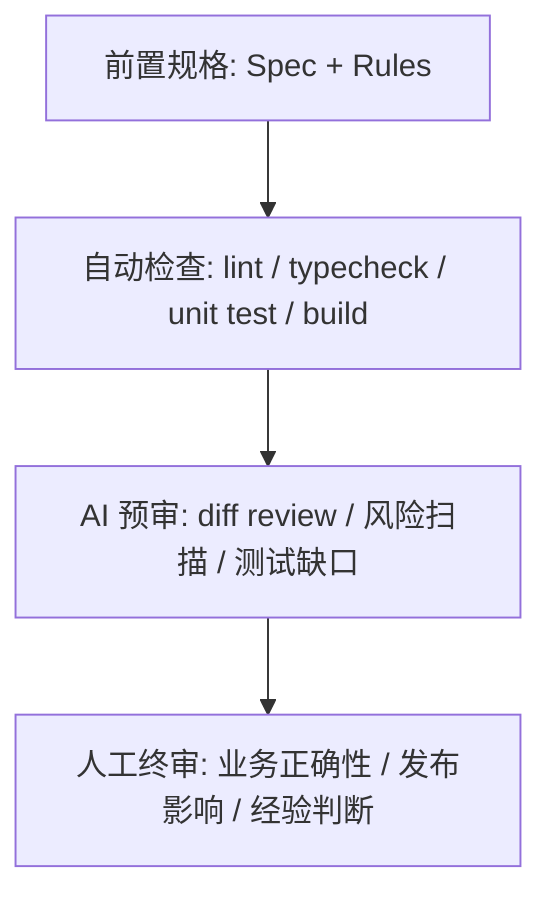
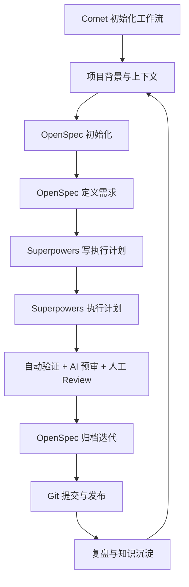

# SDD 开发流程分享

> 主题：从“AI帮我写代码”到“规格驱动的生产级交付”

## 01. 什么是 SDD

SDD 是 Spec-Driven Development，规格驱动开发。它不是多写几份文档，而是把需求、边界、约束、验收和执行计划变成研发过程中的“契约”。代码、测试、Review 和发布都围绕这份契约闭环。

一句话定义：

> SDD = 先把问题讲清楚，再让人和 AI 围绕同一张图纸协作交付。

## 02. 为什么现在重新讨论 SDD

AI 编程让代码生成速度显著提升，但也放大了四类问题：

- 需求没澄清，AI 很快写出“看起来正确”的错误实现。
- 上下文不完整，输出难以达到生产级一致性。
- 缺少边界规则，容易越权改动、破坏架构、引入隐性风险。
- 验证方式滞后，返工发生在后期，成本更高。

SDD 的价值是把“速度”接入“方向盘”和“刹车系统”。

## 03. SDD 与现有开发模式比较

| 模式 | 驱动力 | 优势 | 风险 | AI 时代的适配 |
|---|---|---|---|---|
| 传统瀑布 | 完整需求文档 | 边界清楚 | 反馈慢 | 规格可用，但迭代弹性不足 |
| 敏捷迭代 | 用户故事和 Sprint | 快速反馈 | 规格碎片化 | 需要更强上下文沉淀 |
| TDD | 测试先行 | 行为可验证 | 难覆盖产品意图 | 是 SDD 的验证层 |
| BDD | 业务行为 | 利于协作 | 工程约束弱 | 可作为需求澄清语言 |
| SDD | 规格契约 | 降低返工，稳定 AI 输出 | 初期需要纪律 | 非常适合 AI 协同研发 |

## 04. SDD 总流程

## 05. 前置准备

### 业务背景

- 当前业务目标是什么？
- 用户是谁，核心场景是什么？
- 成功指标和失败代价是什么？

### 约束 rules

- 架构边界、代码规范、命名规范。
- 禁止修改的目录、接口、兼容性要求。
- 安全、性能、权限、审计等红线。

### 技术上下文 context

- 项目结构、核心模块、调用链。
- 依赖版本、构建命令、测试命令。
- 已有设计、历史决策、约定俗成的实现方式。

### 验证方式

- lint、typecheck、unit test、integration test、build。
- 回归范围、手工验收路径、发布验证。

### 历史 BadCase

- 线上事故、返工案例、Review 高频问题。
- AI 曾经误改、漏测、误解的场景。
- 把坏案例变成 rules 和 checklist。

## 06. 如何开发一个完整需求

### 需求澄清

需求澄清不是写代码，而是把问题解释清楚。重点问：

- 要解决谁的什么问题？
- 当前流程哪里不满足？
- 必须支持哪些场景，明确不支持哪些场景？
- 数据从哪里来，到哪里去？
- 如何判断“完成”？

### Context 上下文装配

生产级输出依赖完整上下文。建议装配：

- 业务上下文：业务术语、状态流转、用户角色。
- 技术上下文：相关模块、接口、数据库、调用链。
- 约束上下文：rules、架构边界、兼容性要求。
- 验证上下文：测试命令、构建命令、验收入口。
- 历史上下文：BadCase、事故、重复踩坑点。

### Spec：结构化契约

Spec 要讲清楚：

- 背景：为什么做。
- 目标：做成什么样。
- 范围：本次包含什么。
- 非范围：本次明确不做什么。
- 方案：关键设计、接口、数据、状态。
- 风险：兼容、性能、安全、迁移。
- 验收：可验证的完成标准。

Spec 是图纸，不是作文。图纸越清楚，返工越少。

### Checklist：验收清单

Checklist 把 Spec 变成可勾选的判断项：

- 功能路径是否覆盖。
- 边界条件是否覆盖。
- 错误处理是否覆盖。
- 数据兼容是否覆盖。
- 测试和构建是否通过。
- 文档和知识库是否更新。

### Plans / Tasks：执行计划

计划不是“我要改代码”，而是明确：

- 改哪些文件，为什么改。
- 每一步输入和输出是什么。
- 每一步怎么验证。
- 出错时回退或调整策略是什么。

## 07. AI 执行：人把关

建议设置四层质量门禁：

重点：AI 可以加速执行，但质量责任仍然需要工程体系承接。

## 08. 常见 SDD 工具

| 工具 | 适合场景 | 核心价值 |
|---|---|---|
| Spec-kit | 轻量规格模板 | 快速把需求结构化 |
| OpenSpec | 需求探索、变更提案、归档 | 管理迭代目标和边界 |
| Superpowers | 计划编写、执行、验证 | 提高代码执行质量 |
| Comet | OpenSpec + Superpowers 编排工具 | 五阶段自动化、状态管理、断点续跑 |
| LeanSpec | 精简规格与验收 | 适合轻量团队 |
| OMM | 组织记忆和方法沉淀 | 把上下文变成长期资产 |

## 09. Comet 在 SDD 中的位置

这里的 Comet 指 `rpamis/comet`：一个把 OpenSpec 和 Superpowers 串起来的 agent skill harness。它的目标不是替代两者，而是把“需求定义、深度设计、计划编码、验证收尾、归档同步”编排成一条带状态和门禁的自动化流水线。

Comet 的核心定位：

- OpenSpec 负责 WHAT：proposal、spec lifecycle、archive。
- Superpowers 负责 HOW：technical design、plan、execution、wrap-up。
- Comet 负责 FLOW：自动识别阶段、触发对应技能、校验状态、同步文档。

五阶段流程：

- `/comet-open`：打开变更，产出 proposal、design、tasks。
- `/comet-design`：深度设计，产出 Design Doc 和 delta spec。
- `/comet-build`：计划与编码，产出 Implementation Plan 和代码提交。
- `/comet-verify`：验证与收尾，产出 verification report。
- `/comet-archive`：归档，同步 delta spec 到主 spec 并归档变更。

它解决的关键问题：

- 长任务中断后，能根据 `.comet.yaml` 和 active Spec 识别当前阶段并继续。
- 通过 phase guard 防止 Agent 只说“完成”却没有满足退出条件。
- 把 OpenSpec 变更文档和 Superpowers 设计/计划文档连接起来。
- 用脚本维护状态、验证证据、归档同步，减少“记得更新文档”的人工提醒。

Guard & Automation Scripts：

| 脚本 | 作用 |
|---|---|
| `comet-env.sh` | 脚本发现助手，导出 `COMET_GUARD`、`COMET_STATE`、`COMET_HANDOFF`、`COMET_ARCHIVE` 等路径 |
| `comet-guard.sh` | 阶段转换门禁，校验退出条件，`--apply` 可自动更新 `.comet.yaml` |
| `comet-handoff.sh` | 设计交接，基于 OpenSpec artifacts 生成可追踪的上下文包 |
| `comet-archive.sh` | 一键归档，校验状态、同步 specs、移动 archive、更新状态 |
| `comet-yaml-validate.sh` | `.comet.yaml` 结构和字段值校验 |
| `comet-hook-guard.sh` | 阶段写入保护，限制 open/design/archive 等阶段的文件写入 |
| `comet-state.sh` | 统一状态管理，作为 Agent 操作 YAML 状态的接口 |

这些脚本把容易散落在 Prompt 里的流程控制，变成可执行、可验证、可复用的工程基础设施。

参考：

- GitHub：https://github.com/rpamis/comet

## 10. 黄金组合：OpenSpec + Superpowers

OpenSpec 擅长：

- 需求探索和功能定义。
- 结构化描述项目需求。
- 明确迭代目标和边界。
- 归档与文档同步。

Superpowers 擅长：

- 高质量代码执行。
- 制定详细执行计划。
- 自动化代码实现。
- 测试与质量保障。

组合方式：

## 11. BPM 项目 SDD 开发流程

### 1. 项目背景及上下文构建

- 使用 `comet init` 初始化 Comet 工作流，将 OpenSpec、Superpowers、CodeGraph 等能力串联到项目。
- 使用 `codegraph init` 创建代码索引，可选。
- 使用 `/Context init wiki` 创建项目上下文目录，制定项目 rules、技术上下文。
- 使用 `/Codegraph spec generate` 生成项目原始 Spec 文件，针对 BPM 项目。

### 2. 初始化项目

- 使用 Comet 初始化 SDD 工作流。
- 执行 `comet init`，按项目选择安装范围、语言、AI 平台和依赖。
- Comet 会部署相关 skills，并创建 `docs/superpowers/specs/`、`docs/superpowers/plans/` 等工作目录。

### 3. 定义需求

- 使用 `/comet-open` 打开变更。
- 底层由 OpenSpec 管理 proposal、design、tasks。

### 4. 写执行计划

- 使用 `/comet-design` 做深度设计。
- 使用 `/comet-build` 进入计划与编码阶段。
- 底层由 Superpowers 产出 Design Doc、Implementation Plan 并执行实现。

### 5. 执行计划

- Comet 按阶段触发对应技能，维护 `.comet.yaml` 状态。
- phase guard 会检查任务、状态字段、验证证据和归档条件。

### 6. 归档迭代

- 使用 `/comet-verify` 生成验证报告。
- 使用 `/comet-archive` 同步 delta spec 到主 spec 并归档变更。

### 7. 提交代码

- 确保所有更改已提交版本仓库。
- 完成从需求、代码、测试、文档到复盘的闭环。

## 12. BPM 流程图

## 13. 讲述建议

- 先讲痛点：AI 让写代码变快，但也让“写错代码”变快。
- 再讲定义：SDD 是把模糊需求变成可执行契约。
- 重点讲流程：澄清、上下文、Spec、计划、执行、验证、归档。
- 最后讲落地：BPM 项目用 Comet 编排 OpenSpec + Superpowers 的五阶段流程，用 CodeGraph 和 Context 管代码与项目上下文。

## 14. 结论

SDD 不是为了制造流程负担，而是为了让人、AI、代码库和知识库对齐。真正的收益不是“多一份文档”，而是减少返工、减少误解、提高交付确定性。
