## **我爬取了知乎从2010年到2026年总共620476个回答**

我之前看到经常看的一个答主的新文章里面「不是」这个词的占比过多，就怀疑可能用了ai创作，同时想到了一个问题

> ai发明前人们有多高的频率用「不是」、「而是」？

为了这个问题，我爬取了知乎从2010年到2026年总共**620476**个回答，具体爬取方法结尾给出。

我希望我的爬取**是随机、均匀的**，不会偏向高赞，只选取**200字符以上**的回答，这样避免抖机灵纯玩梗的回答。

（gpt 6作为最会玩小游戏之ai，指arc agi 3，和知乎斗智斗勇了300回合也没找出非常理想的爬取方法）

这620476个回答的分布如下，大多数月份超过1000条/月。

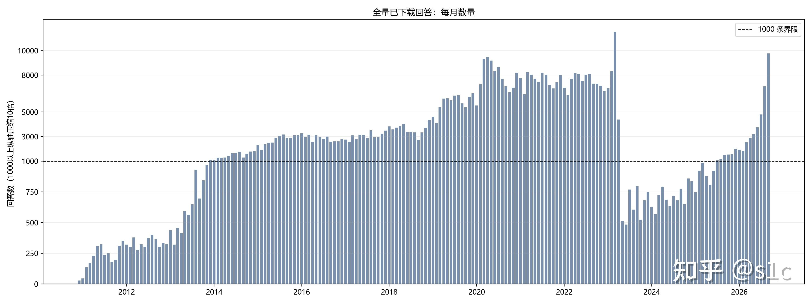

回答按照时间的分布

  

---

  

## 不是、而是

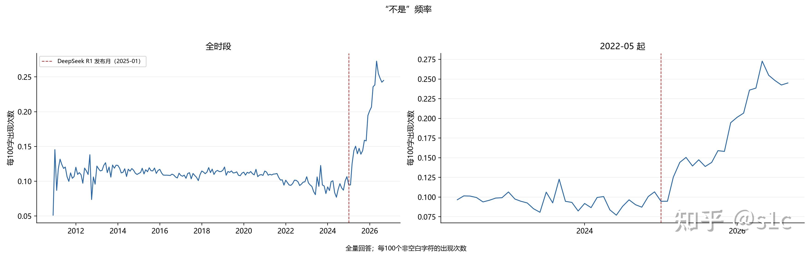

&#39;不是&#39;频率变化图

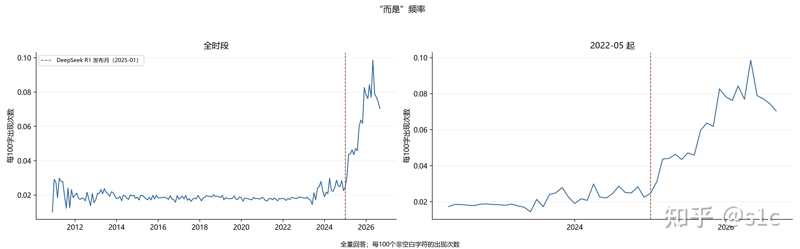

&#39;而是&#39;频率变化图

不是而是句式大致源于英文“金句”句式 **not ……, but ……**，或者句式 **rather than**，ai通过某种对齐方式学会了这样的表达，可能认为加了之后人类更喜欢，加了之后更接近金句。

一开始人类确实看了觉得ai挺聪明（指刚出来的时候看不出是ai味），但是后来套路化之后人类也“审美疲劳”了，也顿悟了之前自己觉得写的不错的文章其实是ai生成的。

现在ai直出文章直接用 不是而是 句式变少了，但是还是会存在很多不必要的转折，或者说单独使用 不是 或者 而是。

我虚线标出的点是 2025 年1月，是deepseek r1发布的时候，可以看到，在这个时间点后面这两个词出现频率飙升。对比来看，chatgpt发布的时候是22年11月。

## 破折号

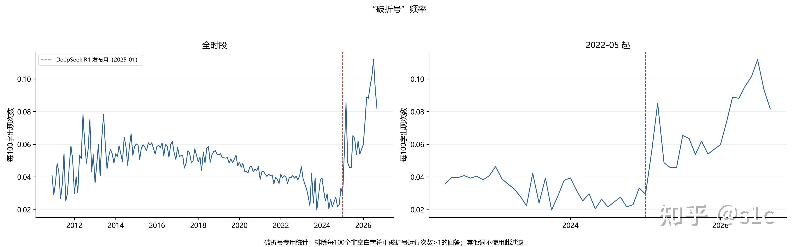

破折号频率变化图

破折号的统计会受到古诗词，名人名言的回答的影响，我想研究的是正常文章里面的统计，所以排除了出现频率超过一次/百字的文章。可以看到，也是在最近疯狂上涨。

ai比较喜欢用破折号——这很可能因为破折号是一个承接的好词，放在很多地方都很适用。

## 稳稳接住

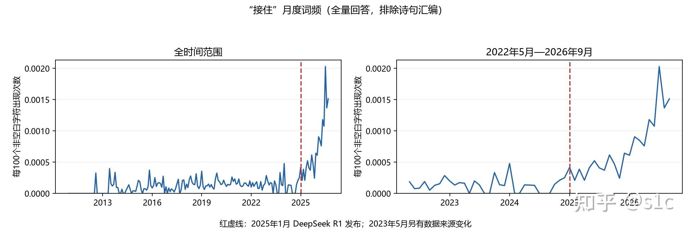

“接住”频率变化图

接住这个词来自于英语 **catch** 的直接翻译，我觉得这个词在中文并不是自然表达。但是ai会认为这个词非常温柔，非常像是知心朋友。

考虑到本身被使用的不是很多，所以之后词频的变多很可能有一部分是人们在调侃gpt腔“稳稳接住你”。

## 先说结论

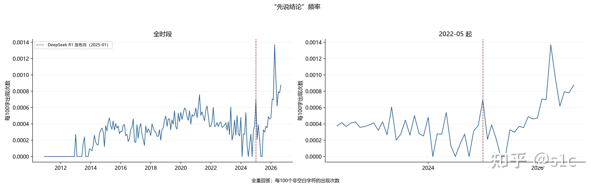

有些知乎用户会说，他们喜欢说“先说结论”为了让不想耐心看的人直接知道立场，避免“立场相同”但是直接评论区开喷的尴尬情况。

我觉得“先说结论”这个词算是某种知乎传统，有一种开门见山我就是要发暴论然后吸引读者的作用。

当然，这个也被当做好词好句进入到了ai的作文积累本里。

## 一些变化不大的词

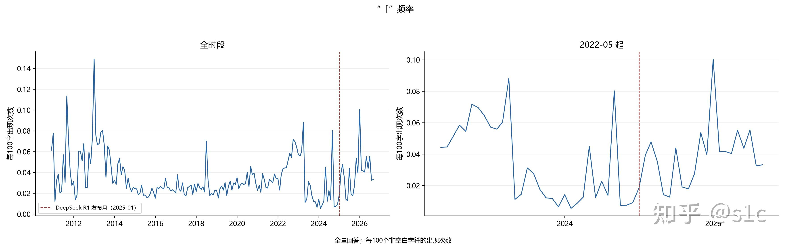

使用 "「」"来装逼是知乎早已有之的传统，没看出太多增长趋势。

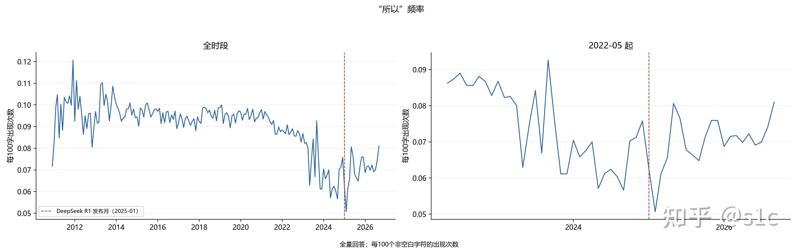

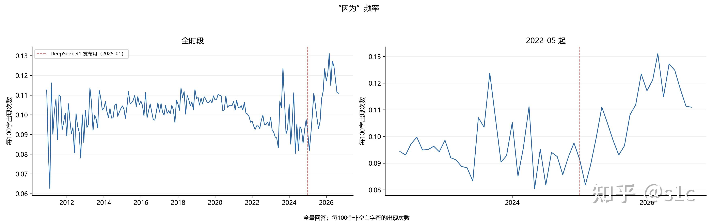

“所以”的频率好像降了一点，但是“因为”的频率好像还升高了一点，感觉变化不大。

## 压抑

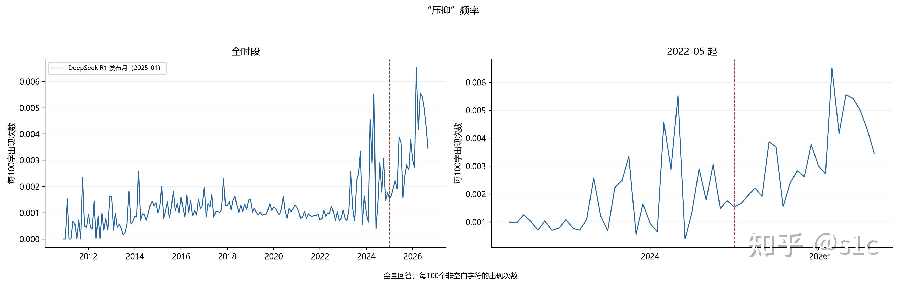

“压抑”这个词在24年前后有爆发，然后26年也讨论很多，这是怎么会是呢？应该不是ai生成文章的特征。

## 特朗普

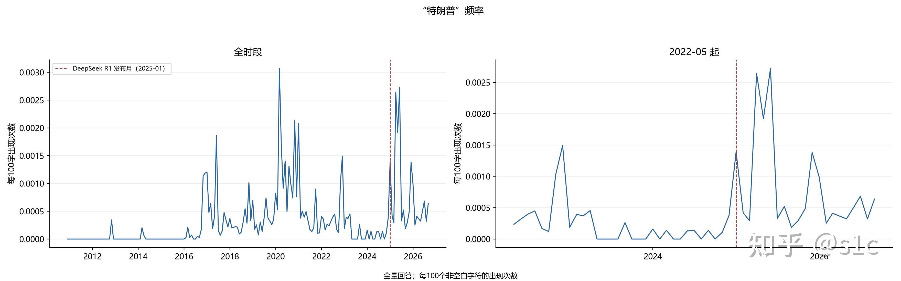

应该是出新闻的时候，大选的时候频率上升比较多。

## 马克思

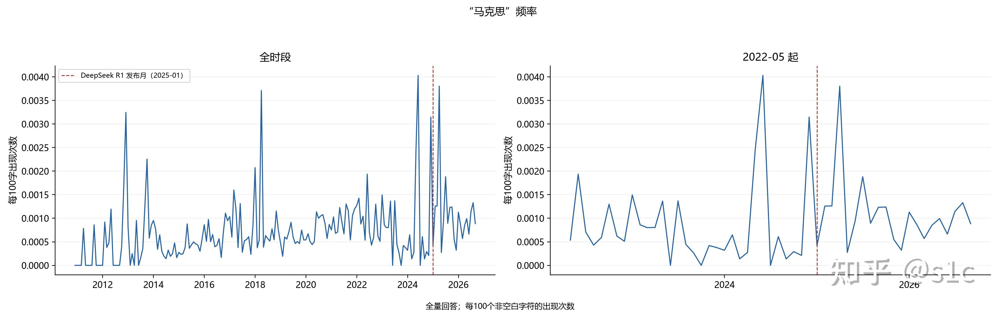

没看出来什么规律。

## AI

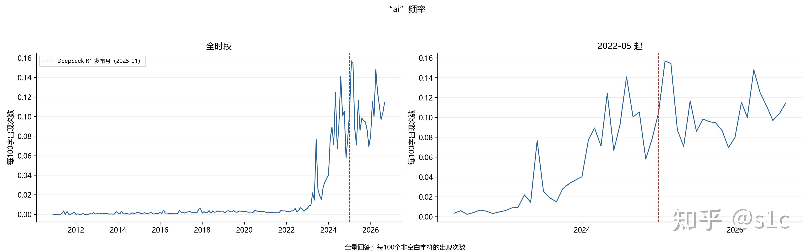

22年年底chatgpt横空出世，加上stable [diffusion](https://zhida.zhihu.com/search?content_id=801505439&content_type=Answer&match_order=1&q=diffusion&zhida_source=entity)生图模型，人们开始增加对ai的讨论。

## 句子长度

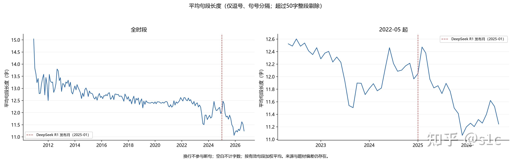

因为有些人不喜欢写逗号和句号，还有一些数据陈述之类的东西，所以超过50字不计入统计。句子长度按照逗号和句号分隔。

可以看到，这个统计数字整体有下降趋势，在2026年触及新低。

我认为用短句进行白描，写出比较“惊艳”的文字，可能是claude发扬的。

用一个例子来看，[孙宇晨](https://zhida.zhihu.com/search?content_id=801505439&content_type=Answer&match_order=1&q=%E5%AD%99%E5%AE%87%E6%99%A8&zhida_source=entity) 的 《我的女友景甜》的平均句子长度是**7.08字**。我认为孙宇晨让claude参与了“润色”过程。

而我认为大概率是手写的[李新野](https://zhida.zhihu.com/search?content_id=801505439&content_type=Answer&match_order=1&q=%E6%9D%8E%E6%96%B0%E9%87%8E&zhida_source=entity)的《人妻约会指南》的平均句子长度是**12.47字**，大概是2019年知乎的平均水平。

  

---

  

## 结尾

本文纯属娱乐属性，但也可以从数据中窥见一斑。

本文的平均句子长度是**15.3字**。完全是我手写的，写得挺随意，长句没有缩减而且小标题也计入句长（同样方法）。

本文收集数据的难度比之前的文章高多了，之前那个活豆包agent都能干，这个活gpt 6来了也没有做得很完美。

具体数据收集方法如下：

```text
（ai总结）数据是怎么收集的？一、最初的目标：尽可能接近普通回答，而不是“知乎精选”这个项目最初想收集的，不是高赞金句，也不是某几个知名作者的作品，而是不同时期普通知乎回答中的语言表达。原因很简单：如果只看高赞回答，看到的可能是平台筛选出来的表达；如果只看几个作者，看到的可能是个人风格变化；如果只看今天的推荐页，又很难找到多年前已经不活跃的用户。因此，我一开始希望做到两种“均匀”：一是时间上尽量均匀，让每个月都有足够的数据；二是内容来源尽量分散，不主动按赞同数筛选，不把某个作者或某个热门问题当成整个知乎。原计划同时收集回答和专栏文章，后来发现二者的入口和元数据获取难度差别很大。本文最终分析的620,476条全部是回答，不包含专栏文章，不能把结果直接推广到知乎专栏。长度门槛定为至少200个非空白字符，没有设置长度上限。这样做是为了减少极短玩梗、抖机灵回答的影响，但它不是一个真正的“玩梗识别器”：短回答也可能有价值，长回答也可能在玩梗。因此，准确说，本文研究的是“已收集到的、至少200字符的知乎回答”，不是所有回答。二、最早尝试：随机抽回答编号最初最有吸引力的办法，是直接随机生成回答ID。假如某个时期的回答编号大致递增，就可以先估计这个时期对应的编号范围，再在范围内随机抽整数，检查这个回答是否存在。如果存在，就读取正文和真实创建时间，再按照实际发布月份归档。这条路的优点是，不需要先经过推荐、搜索或者热门榜单，也不需要挑作者。实测确实读到了不少零赞、低赞回答。但是，它有两个严重问题。第一，随机编号大量落空。编号空间并不等于“每个整数都对应一个可读回答”，还混有空洞、删除或当前不可访问的内容。再叠加200字符门槛，很多请求最后都没有产生可用文本。第二，知乎不同时期的ID机制发生过变化。旧时期的整数编号尚能做区间探测，新时期的巨大编号不能继续按同样的方法高效抽取。能够从编号推测时间，并不意味着能够高概率地随机命中一条回答。因此，随机ID盲探虽然在抽样思路上很有吸引力，却没有成为最终的大规模采集路线，更不能说它实现了2010—2026年统一的全站等概率抽样。三、速度实验：瓶颈不只是程序跑得快不快为提高效率，项目尝试过单条回答接口、浏览器页面读取、页面内嵌初始数据，以及接口失败后回退页面的混合方案，也检查过现成的知乎采集工具。接口通常更快，页面内嵌数据有时可以作为补充，但浏览器读取并不能消除平台的安全验证。几次较快的试采在十几分钟后出现了安全验证。其中有一次限速器实现存在漏洞：页面请求没有经过全局限速，实际访问速度远高于设定值。这次试验不能当成低速采集失败的证据。修复限速后，曾以约每分钟6次请求完整运行一小时，没有触发验证，但只得到22条合格文本。这个结果说明，在大量请求都用于判断随机编号是否存在的情况下，单纯提高代码性能并不能解决产出问题。后来真正有效的改进，是提高“每次请求能拿到多少条有效回答”，而不是继续增加标签页或agent数量。多agent主要用于查资料、分析数据和检查代码；共享同一个账号或网络出口时，多开agent并不会空增加平台允许的访问量。采集中遇到安全验证会停止，不以自动解验证码、切换账号或切换出口的方式继续冲量。四、公开数据集：解决历史规模，但带来来源偏差在线盲探成本太高后，项目检查了GitHub、Hugging Face等处已有的知乎语料。筛选时，正文之外最重要的是回答ID和创建时间。没有时间的数据无法画月度趋势；没有可靠ID的数据难以去重；模型训练集中的改写文本，也不能直接当成原始知乎回答。最终历史数据的主体来自：https://huggingface.co/datasets/wangrui6/Zhihu-KOL这个数据集有五个分片，合计约100.6万条回答记录。经过本项目的长度门槛、回答身份校验等处理，最终主库中有528,324条来自这个来源。另外导入了公开的zhihu_26k数据集，其中16,010条进入最终主库：https://huggingface.co/datasets/liyucheng/zhihu_26k必须说明：这些数据不是我逐条从知乎现抓的。“620,476条回答”是公开历史数据与本项目在线采集结果合并、清洗、去重后的数量。公开数据集也不等于无偏数据集。尤其Zhihu-KOL没有提供足以证明全站等概率抽样的完整说明，不能因为它数量很大，就把它当成全知乎的随机缩影。它在最终主库中约占85.15%，这是本文最重要的来源限之一。五、最终在线方法：先找问题，再批量读取回答后续在线采集的主要路线，是先取得问题入口，再分页读取问题下的回答。与“一次请求只检查一个随机回答ID”相比，这样一次请求可以返回一批回答，同时取得正文、回答ID、问题ID、创建时间，以及可用的互动元数据。问题入口并不只来自一种渠道，包括已有语料关联的问题、搜索发现的问题、日期相关入口，以及公开的历史热榜归档等。热榜归档的作用是寻找过去存在的问题，不是把“上榜日期”当成回答发布时间。一个2021年的问题，完全可能在2025年继续产生回答，所以最终归月始终使用回答自身的创建时间。为了补足时间覆盖，调度程序会优先处理缺数据的月份，复用已经证明能产出相关时期回答的问题分页，并在不同问题之间轮换；过于难补的早期月份则设置请求预算，不再为了凑齐数字无限盲探。这比随机ID盲探高效得多，但它仍有局限：问题入口不来自完整的全站问题总表，搜索有排序偏差，热榜有热点偏差，问题内分页也不能保证每条回答具有相同的入选概率。随机挑问题，更不自动等于随机回答。另外，程序虽然不以赞同数作为收录门槛，但上游数据集、问题发现方式和接口返回顺序仍可能间接影响样本。我们没有把“未主动筛高赞”写成“已经证明不存在热度偏差”。六、怎样清洗、去重和归月不同来源最终统一成回答记录，主要保留正文、回答ID、问题ID、创建时间、来源标签，以及能够可靠取得的互动信息。跨来源按照精确回答ID去重，同一回答不会因为被不同途径读到而重复计算。月份按回答自身的首次创建时间、北京时间划分，不用问题创建时间、热榜出现时间、下载时间或最后编辑时间代替。少量公开数据时间字段没有时区信息的情况，也在记录中保留了解释假设。正文按非空白字符计数，至少200字符才进入主分析库。无法可靠确认回答身份的记录不进入主库；对读取失败也区分明确不存在与状态未知，不把403、超时或安全验证当成“回答不存在”。需要特别区分“发布时间”和“文本版本”：本文按原始创建月份分组，但分析的是数据集中保存的文本或采集时读取的文本。如果作者后来改过回答，我们并没有完整的历史版本，因此不能保证某条2018年回答，其现存文字在2018年就完全如此。七、从“每月1000条”转向“使用全部已下载回答”项目中途做过一版月度配额样本：在已收集的数据框里，每月最多保留1000条，并对同一问题在单个月份中的入选数量设置上限，通过固定规则选择记录。这可以减少某些月份或者大问题对展示样本的数量支配，但不能修复上游来源偏差。每个月都抽1000条，不代表每个月都是同一种人、同一种题材，也不代表全站无偏。后来为了充分使用已有数据，本文改用全部符合条件、已经下载并去重的回答，不再截成每月1000条，也不再沿用那版同题月度数量上限。最终统计框为620,476条回答，覆盖2010年12月至2026年9月，共190个月，其中128个月达到至少1000条。各月份数量并不相等，早期和部分中间月份仍然较少，没有用插值或复制内容填平。每个词的月度频率，按“当月出现总次数÷当月非空白字符总数×100”计算。这样不会仅因为某个月下载得多，就机械地显示更高词频；但月份之间题材、作者、来源和文本长度构成不同的问题仍然存在。八、为什么2023年会出现断层真正需要提醒读者的来源断点是2023年5月，不是2024年，也不是图中标出的DeepSeek R1发布月份。历史KOL数据覆盖到2023年4月。2023年4月的4394条回答中，4076条来自KOL，占92.76%；到了2023年5月，512条回答中来自KOL的数量变成0，主要依赖在线补采等来源。这同时造成了数量断层和来源断层。不能把这里的任何曲线变化，都解释成知乎用户或者AI使用习惯突然发生变化。句长统计还暴露了一个额外的格式问题：早期KOL纯文本大量丢失了换行，而后期在线正文保留了段落换行。如果把换行作为断句符，2023年4月至5月的平均句段长度会从12.17字降到11.44字，看起来像突然变短。但对同一批文本统一忽略换行、只按逗号和句号断句后，结果是12.23字到12.31字，原来的台阶失了。因此，本文最终的句长统计统一不把换行作为分隔符，只按中英文逗号、句号划分；忽略空段和空白字符，超过50个字符的句段整段剔除，再计算所有有效句段的平均长度。50字是本项目的操作性门槛，不代表正常语言中不可能出现更长的句子。统一忽略换行修复了这次明显的格式差异，但没有消除来源和题材偏差。九、分析中的额外过滤主库仍保留全部620,476条回答，但个别图有明确说明的分析过滤。普通词频统计沿用了排除一篇大型古诗汇编回答的口径，因此对应620,475条。破折号尤其容易被“名言——作者”“诗句——出处”式汇编影响，因此该项单独排除每百个非空白字符中破折号出现次数超过1次的回答。连续的“——”计为一次，不按两个符号计算。这项过滤共排除2868条，剩617,608条，只用于破折号图。这些记录没有从原始数据中物理删除，过滤规则和清单都保留下来。密度过滤也不是完美的内容分类器，可能同时排除部分正常使用破折号较多的回答。十、最后怎样理解这份数据这个项目追求均匀，是因为我不希望预先挑选最符合自己猜想的作者、题材或高赞文章；也不希望一张趋势图实际上只是某个作者、某个大问题或者推荐算法的变化。但经过实际探索，我没有找到一个同时兼顾全时期、全站等概率、足够大规模和可接受采集成本的方案。因此，最准确的描述是：这是一份结合公开历史语料与在线补采、努力扩展时间和问题覆盖的知乎回答观察样本，而不是经过证明的全知乎无偏随机样本。这些曲线能展示“本样本中某些表达随时间发生了什么变化”，可以作为进一步研究的线索；它们不能单独证明AI导致了这些变化，更不能凭某个词出现得多，就判定某位作者使用了AI。追求均匀是这个项目的初心；把没有做到均匀的地方、探索中的失败，以及数据处理造成的假象说明白，也是这个项目的一部分。
```