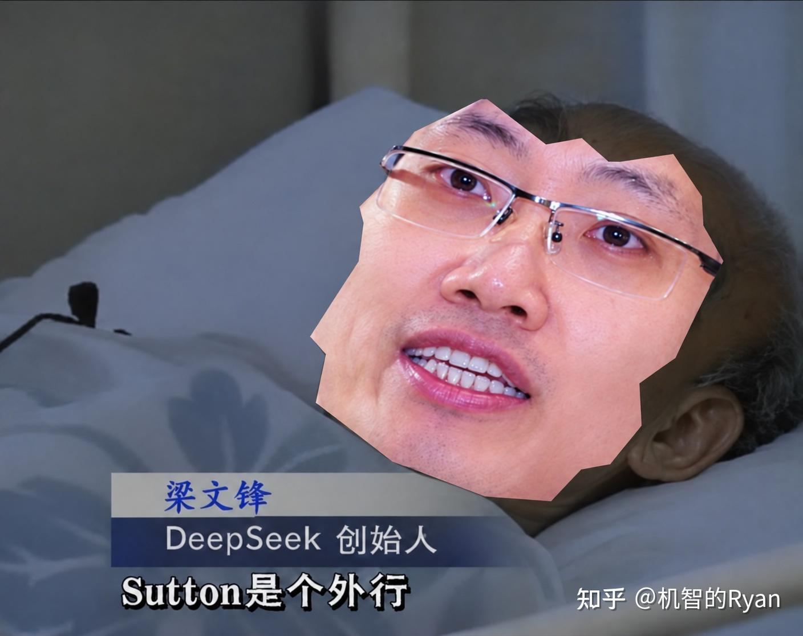
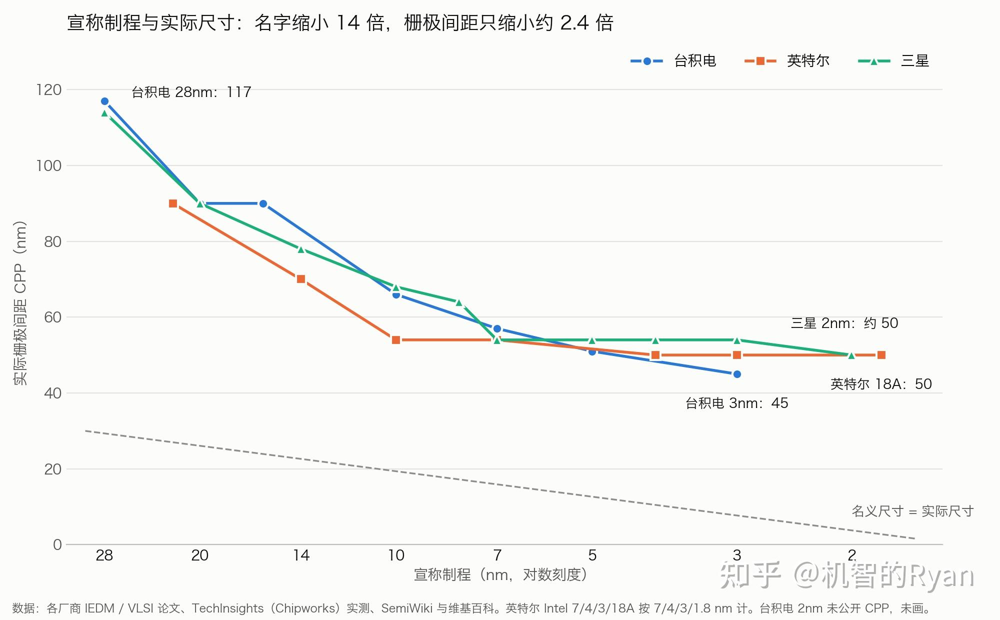
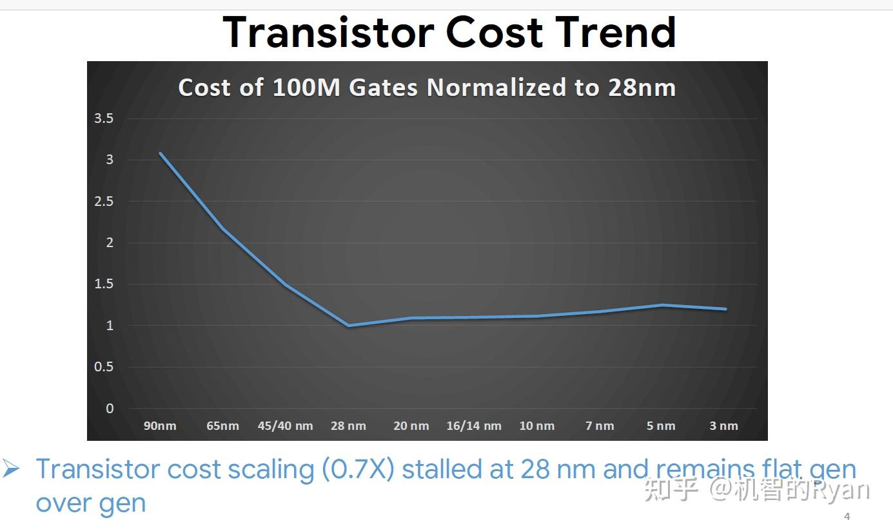
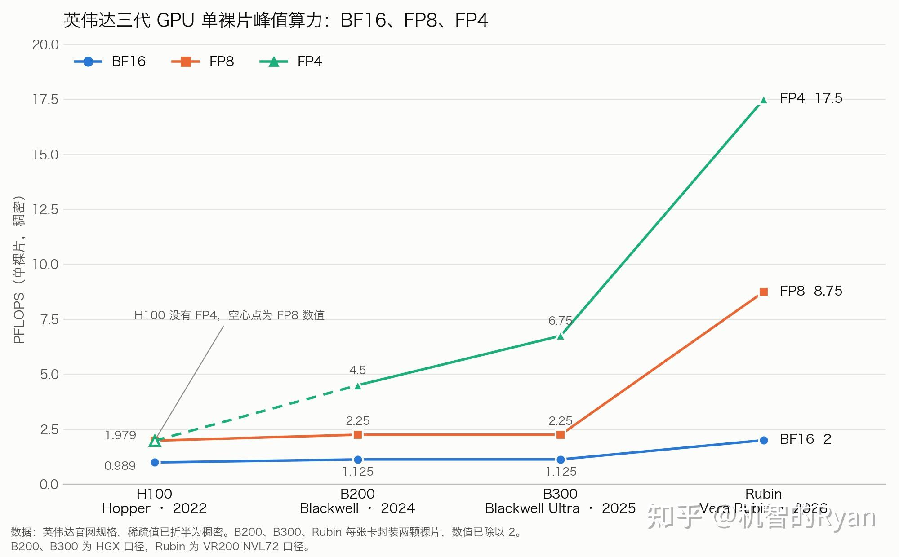
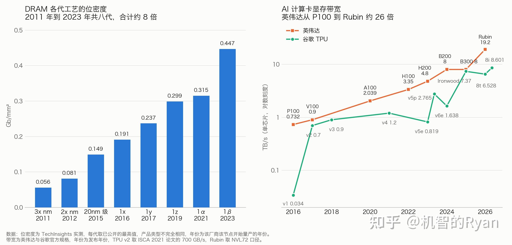

大语言模型追求简洁的时代结束了！

一个肮脏、繁杂、充满先验的算法的时代已然开启！[Engram](https://zhida.zhihu.com/search?content_id=286806268&content_type=Article&match_order=1&q=Engram&zhida_source=entity) 就是第一个。\[1\]

sutton是个外行

  

---

我们先回顾理查德·萨顿（Richard Sutton）所提到的《苦涩的教训》。\[2\]

他提出设计算法时不应该依赖于人类的先验，而要采取通用且能够利用大量计算的方法，来获得通用的智能。

而方法一般有两种，搜索和学习。

曾经的大语言模型是这条线路的绝佳践行者，它用简单统一的 Transformer 架构，将所有自然语言处理任务统一到同一个模型里，并且投入了巨量的学习和数据，获得了极好的性能。\[3\]

然而到了今天，苦涩教训中所依赖的前提已然不成立，对通用简洁的追求或要让位于对效率的极致追求。

Bitter Lesson 为什么成立？原文中是这么写的：

> The ultimate reason for this is Moore’s law, or rather its generalization of continued exponentially falling cost per unit of computation.\[2\]  
> 其最终的原因是摩尔定律，或者说是它更一般的形式，即单位计算的成本持续呈指数级下降。

而此言完全不成立。

我们已知摩尔定律已经停了很多年，尽管芯片制造商标榜他们的芯片制程，一路从1990年的 1微米，一路下降到今天的1纳米，好像尺寸缩小1000倍，而算力增长100万倍。

然而实际上，所谓的1纳米皆是虚标，是为了宣传所使用的产品口径，与现实尺寸已毫无关系。

图片来源：\[4\]\[5\]\[6\]\[7\]

  

  

与此同时，随着每一代制程的工艺逐渐复杂，投资日益增多，每晶体管的成本出现不降反增的趋势，叠加最近几年由 AI 带来的半导体短缺，价格反而更贵了。\[8\]

图片来源：Google 的 Milind Shah 在 IEDM 2023 上的报告，经 Tom&#39;s Hardware 转载\[8\]

那么半导体尺寸没有微缩，是否能靠更好的芯片设计来弥补呢？

从趋势上来看，在这方面我们仍有几倍的提升空间，但不会比如说低精度计算的算力提高了许多，从 [H100 INT8](https://zhida.zhihu.com/search?content_id=286806268&content_type=Article&match_order=1&q=H100+INT8&zhida_source=entity) 2 PFLOPS 已经提升到 Vera Rubin 时代的 35 PFLOPS，然而在这条路上继续走下去，提升空间已然很有限。\[9\]\[10\]

毕竟，哪怕最极限来说，BitNet 也到头了。\[11\]\[12\]

图片来源：\[9\]\[13\]\[10\]

同时，内存的进步也不是无限提升的。

首先，DRAM 的存储密度并没有太多的提升。\[14\]

图片来源：\[15\]\[16\]\[17\]\[18\]\[19\]\[20\]\[21\]\[9\]\[22\]\[23\]\[10\]\[24\]\[25\]\[26\]

提升的主要是更好的封装手段带来的带宽的提升。

比如说像 [2.5D 封装](https://zhida.zhihu.com/search?content_id=286806268&content_type=Article&match_order=1&q=2.5D+%E5%B0%81%E8%A3%85&zhida_source=entity)之类的技术，让内存与芯片交流更紧密。3D 封装甚至可能更进一步。

因此这方面仍有一个数量级的提升空间。

……

然而这都和世界对于词元价格持续下降的追求有极大的差距。工程师们只能提出更激进的办法。\[27\]

我们这里需要区分推理侧和训练侧。

训练侧随着更多的用户和其资源消耗量的指数上升，大模型公司也有更多的算力分配到研发，于是还能提升10倍到20倍。\[28\]

但是，词元价格标志着推理时我们所能分配到的算力，那么这个数字必须每年下降很多。

两股趋势完全相反的方向，实际上指向了一个越来越奇怪的未来。

比如过去的优化方法，大多同时对训练侧和生成侧有用，比如混合专家模型、低精度计算等等，还有那个稀疏注意力。

但当训练成本完全不是考虑因素时，有一些取舍就未必最优了。

因此，当苦涩的教训最根本的前提不成立后，算法的趋势也不会遵循萨顿的指导。

我们已然看到此事发生。

在过去很久时间，分词器都是大语言模型唯一肮脏且依赖人类先验的组件，中间的主体已经非常的简洁通用，但是这件事正在发生改变。

Engram 可以说是第一个进生产环境且非常肮脏的算法。\[1\]\[29\]

离散加速，稀疏的本质依赖于数据表达离散性。

为此，我们需要先从叠加的潜在空间通过某种查表回到稀疏的分类空间。

而这种转换是需要成本的，越稀疏，你所需要做的矩阵乘法越大。

然而，对于语言来说，人类文明在发明过程中，等于已经将繁杂的现实世界进行了抽象和分离，所以已经是相当好的一个索引。

尽管如此，想要做更稀疏的抽取，词元仍然不够大。

于是 Engram 便依赖了第二层人类先验，即二元语法和多元语法对于自然语言处理的极大的作用，于是将已然稀疏的分类变得更加稀疏。\[1\]

*（说起来，最近老能听到传言，Engram 不支持多轮训练，因为存储太强而计算太弱。它会出现训练损失函数下降，但验证损失上升的情况。）*

类似的稀疏注意力机制也依赖许多这样先验的帮助，比如[索引器](https://zhida.zhihu.com/search?content_id=286806268&content_type=Article&match_order=1&q=%E7%B4%A2%E5%BC%95%E5%99%A8&zhida_source=entity)让筛选出全局注意力所需处理的少数词元，极大减少了记忆的读取和计算。\[30\]

但是索引器本身的成本变成了大头，因此人们开始依赖于层与层之间词元选择类似这个极强的先验，将索引器的选取跨层复用。\[31\]\[29\]

这样的设计在智谱的 IndexCache 和深度求索最新的 [CSA2](https://zhida.zhihu.com/search?content_id=286806268&content_type=Article&match_order=1&q=CSA2&zhida_source=entity) 中都有极强的体现。\[31\]\[29\]

以上提到两点都是利用稀疏进行加速的方法。

其因，设计不可能简洁，因为稀疏计算的本体便是离散优化。

属于 NP 难类的问题自然不可能很漂亮的解决。

但是业界对复杂架构的探索没有止步于此，另一个进入人们视野的是循环和计算深度的关系。

常见的方法归类两种，一种可以视为词元循环，就是说每一个词的计算之间建立某种依赖性，使得计算的深度可以深得多，以达到潜在推理的效果，比如 Full-bandwidth Transformer。\[32\]

另一种是成块的循环，实际上 FlashAttention 也满足这个要求，不过 FlashAttention 涉及的多是非线性的计算。\[33\]

线性注意力的性质更强\[34\]\[35\]，这方面很推荐大家看 LastKV\[36\]，它利用深层的键值缓存对全局进行更高效的压缩。

然而这些方法都与 GPU 的并行性相冲突。

GPU 的算力和带宽之比已经涨到了800多，它要求每加载一个字节便需对它进行800次计算。\[10\]\[37\]

于是为了去卡住这个数字，并兼顾从预训练、预填充、解码和强化学习时不同的系统设计要求，架构于是变得愈发复杂，以求在这四者之中都有较好的表现。

当然预训练效率变得越发不重要，也可以只兼顾后三者。

---

我们可以换一个角度来理解苦涩的教训。

苦涩的教训为什么反对复杂算法，反对人类先验？

本质原因，原文是这么说的：

> Time spent on one is time not spent on the other.  
> There are psychological commitments to investment in one approach or the other.  
> And the human-knowledge approach tends to complicate methods in ways that make them less suited to taking advantage of general methods leveraging computation.\[2\]  
> 花在一条路线上的时间，就是没花在另一条路线上的时间。  
> 人们在心理上会投入到某一条路线中。  
> 而依赖人类知识的方法往往会把方法变得复杂，使其更难利用那些借助算力的通用方法。

以我理解，他还表达一层意思是人类专家的投入无法规模化。

当算力指数增加，前者便成了瓶颈。

然而，大模型 [RSI](https://zhida.zhihu.com/search?content_id=286806268&content_type=Article&match_order=1&q=RSI&zhida_source=entity)（recursive self-improvement，递归自我改进）的实现，是否意味着“人类专业知识”变成了“智能体专业知识”，也随算力增加，不再是瓶颈了？

另一种理解，自动化的架构或算法的搜索能否视为萨顿所强调的搜索的一种？

---

### 参考

\[1\] [Xin Cheng, Rui Tian, Wangding Zeng, Damai Dai, et al. Conditional Memory via Scalable Lookup: A New Axis of Sparsity for Large Language Models. arXiv:2601.07372, 2026.](https://link.zhihu.com/?target=https%3A//arxiv.org/abs/2601.07372)

\[2\] [Richard Sutton. The Bitter Lesson. Incomplete Ideas, 2019.](https://link.zhihu.com/?target=http%3A//www.incompleteideas.net/IncIdeas/BitterLesson.html)

\[3\] [Ashish Vaswani, et al. Attention Is All You Need. NeurIPS, 2017.](https://link.zhihu.com/?target=https%3A//arxiv.org/abs/1706.03762)

\[4\] [Wikipedia. 28 nm process / 3 nm process / 2 nm process 等制程词条. Wikipedia, 2026.](https://link.zhihu.com/?target=https%3A//en.wikipedia.org/wiki/3_nm_process)

\[5\] [S.-Y. Wu, et al. (TSMC). A 3nm CMOS FinFlex Platform Technology with Enhanced Power Efficiency and Performance for Mobile SoC and High Performance Computing Applications. IEDM, 2022.](https://link.zhihu.com/?target=https%3A//doi.org/10.1109/IEDM45625.2022.10019498)

\[6\] [B. Sell, et al. (Intel). Intel 4 CMOS Technology Featuring Advanced FinFET Transistors Optimized for High Density and High-Performance Computing. VLSI Symposium, 2022.](https://link.zhihu.com/?target=https%3A//doi.org/10.1109/VLSITechnologyandCir46769.2022.9830194)

\[7\] [SemiWiki. IEDM 2022 – TSMC 3nm. SemiWiki, 2022.](https://link.zhihu.com/?target=https%3A//semiwiki.com/semiconductor-manufacturers/tsmc/322688-iedm-2022-tsmc-3nm/)

\[8\] [Anton Shilov. Chips aren’t getting cheaper to make: the cost per transistor stopped dropping a decade ago at 28nm. Tom’s Hardware, 2024.](https://link.zhihu.com/?target=https%3A//www.tomshardware.com/tech-industry/manufacturing/chips-arent-getting-cheaper-the-cost-per-transistor-stopped-dropping-a-decade-ago-at-28nm)

\[9\] [NVIDIA. NVIDIA H100 Tensor Core GPU. NVIDIA, 2026.](https://link.zhihu.com/?target=https%3A//www.nvidia.com/en-us/data-center/h100/)

\[10\] [NVIDIA. NVIDIA Vera Rubin NVL72. NVIDIA, 2026.](https://link.zhihu.com/?target=https%3A//www.nvidia.com/en-us/data-center/vera-rubin-nvl72/)

\[11\] [Hongyu Wang, Shuming Ma, Li Dong, et al. BitNet: Scaling 1-bit Transformers for Large Language Models. arXiv:2310.11453, 2023.](https://link.zhihu.com/?target=https%3A//arxiv.org/abs/2310.11453)

\[12\] [Shuming Ma, Hongyu Wang, Lingxiao Ma, et al. The Era of 1-bit LLMs: All Large Language Models are in 1.58 Bits. arXiv:2402.17764, 2024.](https://link.zhihu.com/?target=https%3A//arxiv.org/abs/2402.17764)

\[13\] [NVIDIA. NVIDIA HGX Platform. NVIDIA, 2026.](https://link.zhihu.com/?target=https%3A//www.nvidia.com/en-us/data-center/hgx/)

\[14\] [Dylan Patel, Jeff Koch, et al. The Memory Wall: Past, Present, and Future of DRAM. SemiAnalysis, 2024.](https://link.zhihu.com/?target=https%3A//newsletter.semianalysis.com/p/the-memory-wall)

\[15\] [TechInsights. DRAM 技术与位密度对比. TechInsights, 2017.](https://link.zhihu.com/?target=https%3A//www.techinsights.com/ko/node/16545)

\[16\] [Jeongdong Choe (TechInsights). DRAM 1x/1y 节点分析. Semiconductor Digest, 2019.](https://link.zhihu.com/?target=https%3A//semiconductor-digest.com/%3Fp%3D5020)

\[17\] [TechInsights. Micron 1α DRAM Technology. TechInsights, 2021.](https://link.zhihu.com/?target=https%3A//www.techinsights.com/blog/memory/micron-1a-dram-technology)

\[18\] [TechInsights. Samsung 1b 16Gb LPDDR5X DRAM. TechInsights, 2024.](https://link.zhihu.com/?target=https%3A//techinsights.com/ja/node/59204)

\[19\] [NVIDIA. NVIDIA Tesla P100 Datasheet. NVIDIA, 2016.](https://link.zhihu.com/?target=https%3A//images.nvidia.com/content/tesla/pdf/nvidia-tesla-p100-datasheet.pdf)

\[20\] [NVIDIA. NVIDIA Tesla V100 GPU Datasheet. NVIDIA, 2018.](https://link.zhihu.com/?target=https%3A//images.nvidia.com/content/technologies/volta/pdf/volta-v100-datasheet-update-us-1165301-r5.pdf)

\[21\] [NVIDIA. NVIDIA A100 Tensor Core GPU. NVIDIA, 2026.](https://link.zhihu.com/?target=https%3A//www.nvidia.com/en-us/data-center/a100/)

\[22\] [NVIDIA. NVIDIA H200 Tensor Core GPU. NVIDIA, 2026.](https://link.zhihu.com/?target=https%3A//www.nvidia.com/en-us/data-center/h200/)

\[23\] [NVIDIA. NVIDIA DGX B200. NVIDIA, 2026.](https://link.zhihu.com/?target=https%3A//www.nvidia.com/en-us/data-center/dgx-b200/)

\[24\] [Norman P. Jouppi, et al. In-Datacenter Performance Analysis of a Tensor Processing Unit. ISCA, 2017.](https://link.zhihu.com/?target=https%3A//arxiv.org/abs/1704.04760)

\[25\] [Norman P. Jouppi, et al. TPU v4: An Optically Reconfigurable Supercomputer for Machine Learning with Hardware Support for Embeddings. ISCA, 2023.](https://link.zhihu.com/?target=https%3A//arxiv.org/abs/2304.01433)

\[26\] [Google Cloud. Cloud TPU 文档（v5e、v5p、v6e、TPU7x 与 TPU 8t/8i 规格）. Google, 2026.](https://link.zhihu.com/?target=https%3A//cloud.google.com/tpu/docs/system-architecture-tpu-vm)

\[27\] [Ben Cottier, Ben Snodin, David Owen, Tom Adamczewski. LLM inference prices have fallen rapidly but unequally across tasks. Epoch AI, 2025.](https://link.zhihu.com/?target=https%3A//epoch.ai/data-insights/llm-inference-price-trends)

\[28\] [Jaime Sevilla, Edu Roldán. Training compute of frontier AI models grows by 4-5x per year. Epoch AI, 2024.](https://link.zhihu.com/?target=https%3A//epoch.ai/blog/training-compute-of-frontier-ai-models-grows-by-4-5x-per-year)

\[29\] [DeepSeek-AI. DeepSeek-V4.1-Flash: Pushing the Limits of KV Cache Compression. arXiv:2609.19969, 2026.](https://link.zhihu.com/?target=https%3A//arxiv.org/abs/2609.19969)

\[30\] [DeepSeek-AI. DeepSeek-V3.2-Exp: Boosting Long-Context Efficiency with DeepSeek Sparse Attention. DeepSeek, 2025.](https://link.zhihu.com/?target=https%3A//github.com/deepseek-ai/DeepSeek-V3.2-Exp/blob/main/DeepSeek_V3_2.pdf)

\[31\] [Yushi Bai, Qian Dong, Ting Jiang, Xin Lv, Zhengxiao Du, Aohan Zeng, Jie Tang, Juanzi Li. IndexCache: Accelerating Sparse Attention via Cross-Layer Index Reuse. arXiv:2603.12201, 2026.](https://link.zhihu.com/?target=https%3A//arxiv.org/abs/2603.12201)

\[32\] [Xi Wang, Ziyang Cai, Zheng Zhan, Harry Dong, Ying Fan, Gustavo de Rosa, Tim Pearce, John Langford. Full-bandwidth Transformer. arXiv:2608.08888, 2026.](https://link.zhihu.com/?target=https%3A//arxiv.org/abs/2608.08888)

\[33\] [Tri Dao, Daniel Y. Fu, Stefano Ermon, Atri Rudra, Christopher Ré. FlashAttention: Fast and Memory-Efficient Exact Attention with IO-Awareness. NeurIPS, 2022.](https://link.zhihu.com/?target=https%3A//arxiv.org/abs/2205.14135)

\[34\] [Angelos Katharopoulos, Apoorv Vyas, Nikolaos Pappas, François Fleuret. Transformers are RNNs: Fast Autoregressive Transformers with Linear Attention. ICML, 2020.](https://link.zhihu.com/?target=https%3A//arxiv.org/abs/2006.16236)

\[35\] [Songlin Yang, Bailin Wang, Yikang Shen, Rameswar Panda, Yoon Kim. Gated Linear Attention Transformers with Hardware-Efficient Training. ICML, 2024.](https://link.zhihu.com/?target=https%3A//arxiv.org/abs/2312.06635)

\[36\] [Zefan Cai, Sai Bi, Lin Zhang, Yicong Hong, et al. Last Layer KV Cache is All You Need. COLM 2026 ER Workshop, 2026.](https://link.zhihu.com/?target=https%3A//zefan-cai.github.io/LastKV.github.io/)

\[37\] [Amir Gholami, Zhewei Yao, Sehoon Kim, Coleman Hooper, Michael W. Mahoney, Kurt Keutzer. AI and Memory Wall. IEEE Micro, 2024.](https://link.zhihu.com/?target=https%3A//arxiv.org/abs/2403.14123)