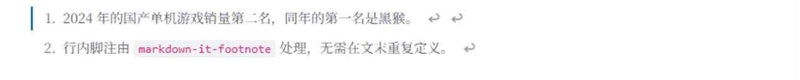
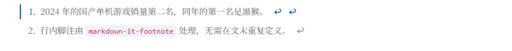
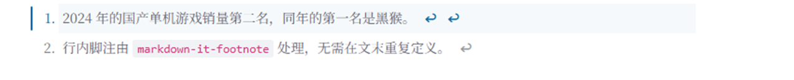
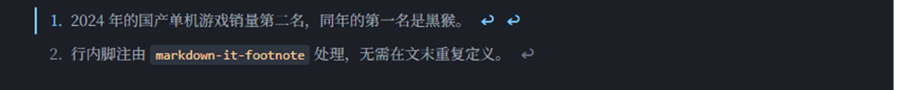
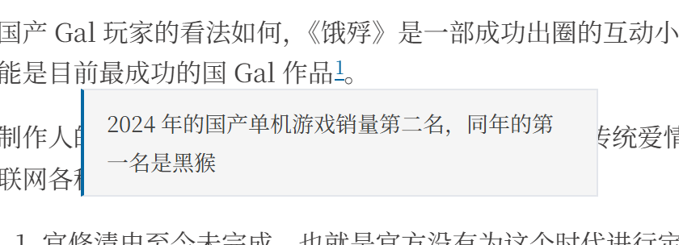
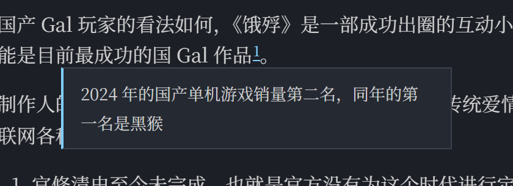

# 脚注渲染审查与四个优化方案

> 2026-11-19 · 对象：hexo-theme-ayeria 1.9.13 / markdown-it-footnote 3.0.3 / Hexo 8.1.1
> 配套原型：`preview.html`（双击打开即可对比「现状 + 四个方案」，带深浅色切换）
> 标记约定：**[实测]** = 本次从源码或构建产物直接读到；**[估算]** = 工作量或风险的推测；**[待验证]** = 需要真机确认。

---

## 0. 结论

现有效果不是"设计得克制"，而是**没有任何脚注样式**——所有视觉都来自 `<sup>`、`<hr>`、`<ol>`、`<p>` 的通用规则继承。因此优化的第一件事不是加装饰，而是**分清哪些部分属于内容层、哪些属于功能层**。

推荐组合（按顺序落地）：

1. **方案 4（HTML 语义修复，约 10 行过滤器）** —— 去掉 `[1]` 的方括号、折叠 `1:1` 这种实现泄漏、补 `aria-label`。这是所有后续视觉方案的地基，且纯 CSS 做不到。
2. **方案 1（精修注释区，纯 CSS）** —— 成本最低、风险为零，解决"注释与正文同号同色、间距比正文还松"的问题。
3. **方案 2（悬浮注释，CSS + JS，功能层）** —— 可选。它改善的是"跳页"这一交互，但会引入一个浮层组件；如果做，文末列表必须保留。
4. **方案 3（页边侧注）** —— 不建议先做。它是这场讨论里最漂亮也最容易翻车的一个，仅当你想要"长文型"阅读体验时再考虑。

> **状态（2026-11-20）**：方案 1 + 方案 4 已实施并验收，另修掉了 `transition` / `border-radius` 两个同名 mixin 的根因（§11）。悬浮预览（hover 脚注）已实现，视觉最终定为「正文引用块形态」——直角、左缘强调色竖线、宋体、不透明底（§12）。页边侧注未做。

---

## 1. 现状：它现在长什么样，为什么

### 1.1 真实输出 **[实测]**

`_config.yml:224` 启用了 `markdown-it-footnote`。用站内同款 markdown-it 与配置渲染，得到：

```html
<p>…作品<sup class="footnote-ref"><a href="#fn1" id="fnref1">[1]</a></sup>。</p>
…

<hr class="footnotes-sep">
<section class="footnotes">
<ol class="footnotes-list">
<li id="fn1" class="footnote-item"><p>2024 年的国产单机游戏销量第二名…
 <a href="#fnref1" class="footnote-backref">↩︎</a></p>
</li>
</ol>
</section>
```

要点：

- 引用号是**字面文本 `[1]`**，方括号来自插件 `render_footnote_caption`，不是 CSS 生成的。
- 同一注释被引用第二次时，编号变成 `[1:1]`，并多出一条回链 `↩︎`（`id` 也随之变成 `fnref1:1` —— 含冒号的 id）。
- 回链字形是 `↩` + U+FE0E（文本表现形式），**没有任何 `title` / `aria-label`**。
- 注释块挂在 `.article-entry` 内部、文末奖励按钮之前。

### 1.2 它继承了什么 **[实测]**

主题的 `source-src/css` 下**没有任何脚注规则**（全库 grep `footnote` 只命中 `_config.yml`）。现有观感全部来自这些通用规则：

| 来自 | 规则 | 对脚注的实际影响 |
|---|---|---|
| `_extend.styl` `$base-style`（由 `.article-entry` @extend） | `sup { font-size: 75%; top: -.5rem; line-height: 0 }` | 引用号小 25%、抬高 5px |
| 同上 | `hr { height: 1px; background: var(--color-border); margin: 1.5rem 0 }` | 分隔线是**与正文分节线同款**的整行发丝线 |
| 同上 | `ul, ol, dl { margin: 1.5rem 0 1.5rem 2rem }` | 注释列表左侧缩进 20px |
| 同上 | `p { margin: 1.5rem 0 }` | 每条注释的 `<p>` 上下各 15px → **条目之间 30px 空隙** |
| `style.styl` | `a { color: var(--color-link) }`（`#0681d0`），不加下划线 | 引用号和回链都是正文链接色 |
| `_tokens.styl` | token 只有颜色与图片亮度，**没有字体 token** | 功能层组件若要用思源黑体，只能重写字体栈 |

### 1.3 问题清单

| # | 问题 | 性质 |
|---|---|---|
| 1 | 引用号 `[1]` 呈强调色，与普通链接同色，方括号像 Markdown 残留 | 视觉 |
| 2 | 注释区与正文**同字号、同颜色、同行距**，滚到文末分不清正论与补注 | 视觉 |
| 3 | 条目间距 30px，比正文段落还松，两条注释像两段正文 | 视觉 |
| 4 | 分隔线复用正文 `<hr>` 语义，读作"分节"而非"注释放这里" | 视觉/语义 |
| 5 | `[1:1]` 把插件实现细节泄漏给读者 | 内容 |
| 6 | 回链 `↩︎` 无 `aria-label`，读屏器读作 "leftwards arrow" | 可达性 |
| 7 | 无 `:target` 样式：点 `[1]` 跳下去、点 `↩` 跳回来，落点没有提示 | 交互 |
| 8 | 正文 `[1]` 与列表 marker `1.` 形态不一致，视觉上不构成"同一物" | 视觉 |
| 9 | 顺带发现：`--color-link` `#0681d0` 在白底上对比度 **4.15:1**，低于 WCAG AA 的 4.5:1；引用号只有 0.72em，问题更明显 | 可达性（既有问题） |

---

## 2. 先定层，再定样式

Ayeria 的双层美学对脚注特别有用，因为它天然分成两半：

| 脚注的组成部分 | 归属层 | 该遵守的规则 |
|---|---|---|
| 正文里的引用号、文末注释列表 | **内容层** | 衬线、无装饰边框、颜色只作语义区分、可读性第一 |
| 点击/悬停后浮出的注释预览 | **功能层** | blur(16px)、12px 圆角、1px 细边、`0 6px 24px rgba(0,0,0,.09)`、opacity+scale 0.22s、light dismiss |

这条划分直接否掉了两种常见做法：给注释区加浅色卡片背景（那是功能层语言混进内容层），以及给浮层用书斋式发丝线（反过来）。四个方案都按这个边界设计。

---

## 3. 方案 1 —— 精修注释区（纯 CSS，内容层）

**效果**：`01-before-after.png` 下半 / `02-scheme-aplus.png`

### 3.1 视觉规则

| 元素 | 从 | 到 |
|---|---|---|
| 引用号字号 | `75%`（≈11.9px） | `.72em`（≈11.4px），抬高 `.44em` |
| 引用号颜色 | `--color-link` #0681d0（4.15:1） | `--fn-ref` #0568a3（**5.97:1**） |
| 引用号下划线 | 无（但也没有 hover 反馈） | 常态无，hover / focus / `:target` 时出现 1px |
| 分隔线 | 100% 宽 × 1px，与正文 `<hr>` 同色 | **6rem × 1px**，`--fn-sep` 更浅 |
| 注释区字号 | 100% | `.9em`，行高 `1.8` |
| 注释区颜色 | `--color-text` | `--fn-text` #5b6270（6.13:1） |
| 列表缩进 | `1.5rem 0 1.5rem 2rem` | `0 0 0 1.8rem` |
| 条目间距 | `<p>` 上下各 1.5rem | `padding .3rem 0`，`<p>` margin 归零 |
| 编号 marker | 默认黑 | `--fn-marker` #6f7783（4.52:1）+ `tabular-nums` |
| 回链 | 链接色、全亮 | 半隐（`opacity .75`），hover 才回到强调色 |
| `:target` | 无 | 条目左缘一条 2px `--fn-ref` 竖线（与分隔线/正文左缘对齐）+ 编号与回链转强调色，无底色；正文被回跳的引用号加下划线 |

### 3.2 新增 token（`_tokens.styl`）

```stylus
:root
  --fn-ref      #0568a3   // 引用号（比 --color-link 深一档，小字号需要更高对比度）
  --fn-text     #5b6270   // 注文
  --fn-marker   #6f7783   // 编号、回链
  --fn-sep      #e3e6eb   // 分隔线

body.darkmode
  --fn-ref      #80cfff
  --fn-text     #aab2bf   // 7.72:1
  --fn-marker   #8d95a3   // 5.47:1
  --fn-sep      #3b414c
```

> 早期版本还有一个 `--fn-hl`（落点底色），改成"只画竖线"后一并删掉了——不留无用 token。

> 为什么引用号不直接用 `--color-link`：该色在白底上只有 4.15:1，而引用号是 0.72em 的小字，比正文更需要对比度。深一档的 `#0568a3` 与原色同色相，不破坏配色体系。

### 3.3 样式（新增 `_partial/footnote.styl`，在 `style.styl` 里 `@import`）

已落地文件即最终版本：`themes/ayeria/source-src/css/_partial/footnote.styl`（90 行）。骨架如下：

```stylus
.article-entry
  sup.footnote-ref
    font-size .72em
    top -.44em
    margin-left .1em

    a
      color var(--fn-ref)
      text-decoration none
      font-variant-numeric tabular-nums
      border-bottom 1px solid transparent
      transition border-bottom-color .18s ease
      &:hover, &:focus-visible, &:target
        border-bottom-color currentColor

  hr.footnotes-sep
    width 6rem
    height 1px
    margin 3.2rem 0 1.5rem
    background-color var(--fn-sep)
    border none

  section.footnotes
    font-size .9em
    line-height 1.8
    color var(--fn-text)

    ol.footnotes-list
      margin 0 0 0 1.8rem
      padding 0

    li.footnote-item
      position relative
      margin 0
      padding .3rem 0 .3rem .4rem
      // 落点：只画一条竖线，不做色块（见 §10.3）
      &:target::before
        content ''
        position absolute
        left -1.8rem          // 抵消 ol 缩进，与分隔线/正文左缘对齐
        top .3rem
        bottom .3rem
        width 2px
        background-color var(--fn-ref)
        border-radius 1px
      &:target::marker
        color var(--fn-ref)
      &:target a.footnote-backref
        opacity 1
        color var(--fn-ref)
      &::marker
        color var(--fn-marker)
        font-variant-numeric tabular-nums

    p
      margin 0

    a.footnote-backref
      margin-left .3em
      padding 0 .15em
      color var(--fn-marker)
      opacity .75
      text-decoration none
      transition opacity .18s ease, color .18s ease
      &:hover, &:focus-visible
        opacity 1
        color var(--fn-ref)
```

### 3.4 成本与取舍

- **[估算]** 样式 60 行 + token 10 行，改完需在 `themes/ayeria` 内 `npm run build`（rollup 输出到 `source/dist/`，**[实测]** 该目录下 rollup 已安装）。
- 不引入 JS，不改变 HTML，不动插件配置。
- 保留方括号 —— 这是方案 1 的已知上限，解决它需要方案 4。
- 可选增强（约 10 行 JS）：悬停正文里的引用号时，给对应的 `<li>` 加一个 `.is-active` 类（复用 `:target` 的视觉），让"点之前"就能看到注释在哪。CSS 无法表达这种跨节点关联。

---

## 4. 方案 2 —— 悬浮注释（CSS + JS，功能层）

**效果**：`03-scheme-b-popover.png`（浅色）、`06-mobile.png` 右栏（390px）

读者不必离开当前段落：点引用号 → 就近浮出注释 → 点外部或 Esc 关闭。跳页行为消失，"回跳后在哪儿"的问题也就不存在了。

### 4.1 与功能层规范的映射

| 规范 | 本组件取值 |
|---|---|
| `backdrop-filter` | `blur(16px)` |
| 背景 | 亮 `rgba(255,255,255,.78)` / 暗 `rgba(42,47,58,.74)` |
| 边框 | `1px solid` `rgba(28,31,38,.10)` / 暗 `rgba(255,255,255,.12)` |
| 圆角 | `12px` |
| 阴影 | `0 6px 24px rgba(0,0,0,.09)` / 暗 `.45` |
| 动效 | `opacity 0→1` + `scale(.96→1)`，`.22s ease`，`transform-origin` 随翻转方向 |
| 字体 | 思源黑体 1.3rem / 1.75 |
| 关闭 | 点击外部、Esc、再次点同一个引用号；`aria-expanded` 同步 |
| 定位 | 优先下方，空间不足翻到上方；水平 clamp 12px 视口边距 |
| 列表 | **保留**文末列表（无 JS、打印、SEO、以及"就爱读尾注"的读者） |

### 4.2 代码骨架（完整可运行版见 `preview.html`）

```js
// 复用已经渲染好的 HTML：点引用号 → 把对应 <li> 的内容搬进浮层
const pop = Object.assign(document.createElement('div'), { className: 'fn-popover' });
document.body.append(pop);

function open(btn) {
  const li = document.getElementById(btn.hash.slice(1)).cloneNode(true);  // 必须 clone
  li.querySelectorAll('.footnote-backref').forEach(a => a.remove());
  pop.innerHTML = `<p>${li.innerHTML}</p><div class="fn-pop-foot">
    <span>注 ${btn.hash.slice(4)}</span><a href="${btn.hash}" class="fn-pop-return">回到正文 ↩</a>
  </div>`;
  pop.classList.add('visible');            // 状态类，遵循 .open/.visible/.active 约定
  place(btn);                              // getBoundingClientRect + 视口钳制
  btn.setAttribute('aria-expanded', 'true');
}
```

### 4.3 两种实现路线

- **自研（推荐）**：约 70 行 JS + 40 行 Stylus。好处是类名、状态类、token 全部按 Ayeria 规范走，和打赏弹窗、分享气泡是同一套语言。
- **现成库 littlefoot**：MIT，v4.1.4，无依赖。它的默认值几乎是照着 `markdown-it-footnote` 的输出长的：`anchorPattern` 默认 `/#(fn|footnote|note)[:\-_\d]/gi` 能命中的就是 `#fn1`，`anchorParentSelector` 默认 `sup`，`footnoteSelector` 默认 `li`。样式可用它暴露的 CSS 变量覆盖成 Ayeria 的样子。
  - 代价一：它会把 `li` 收进弹层并隐藏原列表（留 `littlefoot--print` 给打印），**`hr.footnotes-sep` 和空的 `section.footnotes` 会留在页面上**，还得额外清掉。
  - 代价二：默认按钮是三点 SVG，要改 `buttonTemplate` 才能显示数字。
  - **[待验证]** 我们的重复引用会产生 `id="fnref1:1"`（含冒号），与它内部按 id 取节点的逻辑是否冲突。

### 4.4 成本与风险

- **[估算]** 3–4 小时（含移动端、键盘、深浅色）。
- 移动端建议不照搬：390px 下浮层会盖住正文（见 `06-mobile.png` 右栏），更合适的是底部抽屉，或干脆沿用方案 1 的跳转。
- 可选增强：`activateOnHover`（悬停 250ms 展开）——桌面顺手，触屏无效，需与 click 并存。

---

## 5. 方案 3 —— 页边侧注（CSS + JS，内容层）

**效果**：`04-scheme-c-sidenote.png`

注释不再堆在文末，而是出现在**左栏**、与引用行对齐。这是 Tufte CSS / gwern.net 的阅读体验，也是中文博客里少见的形态。

### 5.1 为什么只能放左边 **[实测]**

站点右侧边距已经被目录占用：`.tocbot { position: absolute; right: -28rem; max-width: 255px }`。也就是说正文右侧那 280px 的空白归 TOC 所有，侧注若放右边会与目录打架。左侧目前是空的（`.sidebar` 在 `left: -8rem` 的离屏位置）。

### 5.2 参数

- 断点：`min-width: 1320px`
  推导（**[实测]** 版心 700px、TOC 右伸 280px、侧注区 `3.5rem + ≤210px`）：两侧各需约 245px → 视口 ≥ 1190px；但右侧 TOC 要 280px → 视口 ≥ 1260px。取 1320px 留余量。
- 定位：`position: absolute; right: calc(100% + 3.5rem); width: clamp(17rem, 15vw, 21rem)`
- 字号：`1.2rem / 1.75`，颜色 `--fn-text` —— 再小中文就糊了
- 对齐：`top = 引用号顶端 − 文章顶端 − 4px`；多条注释冲突时 `top = max(自然位置, 上一条底 + 8px)`
- 悬停引用号 → 对应侧注左侧亮 1px 强调线（`is-active`）
- 降级：`< 1320px` 与 `@media print` 一律回到方案 1 的列表

### 5.3 风险

- **堆叠下滑是结构性的**：注释比正文行多时，后面的注释必然被推离引用行（Tufte 自己的 demo 也有这个毛病）。gwern 用"滑入式侧注"绕开它——悬停才从视口外滑进来。
- 中文侧注列 12px 只有约 13 字/行，长注释会占 5–8 行，把正文挤得很难看。
- 需要 JS 计算位置，滚动/缩放/字体加载后都要重排。
- **[估算]** 6–8 小时，且是四个方案里唯一会"看起来没做好就更糟"的一个。

### 5.4 现成参考

- **Tufte CSS**（MIT）：`float: right; margin-right: -60%; width: 50%` + CSS counter 生成编号；窄屏用 `:checked` 的 checkbox 展开（需要 `<label>` + `<input>` 结构，`markdown-it-footnote` 不会生成，得靠过滤器或 JS 重建）。
- **gwern.net**：双侧边距 + 溢出时滑入的 pop-in，是这套思路最成熟的工程实现。

---

## 6. 方案 4 —— HTML 语义层修复（约 15 行过滤器）

**这是在不改渲染器源码的前提下，唯一能改 HTML 的路径**，原因是：插件不接受 option（v3.0.3 的 `module.exports = function footnote_plugin(md)` 只取第一个参数），而渲染器的 `plugins` 配置只能在 `use()` 时传参，无法在之后覆写 `renderer.rules`。**[实测]**

放 `themes/ayeria/scripts/filters/`（该目录已有 `index.js` 注册机制）。最终实现（68 行，含注释）见 `themes/ayeria/scripts/filters/footnote.js`，三件事：

```js
// 1. [1] / [1:1] → 1
const stripBrackets = html => html.replace(
  /(<sup class="footnote-ref"><a\b[^>]*>)\[(\d+)(?::\d+)?\]/g, '$1$2');

// 2. 注释区语义
const tagEndnotes = html => html.replace(
  '<section class="footnotes">',
  '<section class="footnotes" role="doc-endnotes" aria-label="注释">');

// 3. 回链无障碍名：同一条注释被引用多次时，两条回链要能区分"回第几处"
const labelBackrefs = html => {
  const totals = new Map();
  html.replace(BACKREF, (m, note) => { totals.set(note, (totals.get(note) || 0) + 1); return m; });
  const seen = new Map();
  return html.replace(BACKREF, (match, note) => {
    const nth = (seen.get(note) || 0) + 1;
    seen.set(note, nth);
    const label = totals.get(note) > 1 ? `返回正文引用（第 ${nth} 处）` : '返回正文引用';
    return match.replace('class="footnote-backref">', `class="footnote-backref" aria-label="${label}">`);
  });
};
```

**[实测]** 已接入并 `hexo clean && hexo generate` 验证，输出为：

```html
<sup class="footnote-ref"><a href="#fn1" id="fnref1">1</a></sup>
<section class="footnotes" role="doc-endnotes" aria-label="注释">
<a href="#fnref1" class="footnote-backref" aria-label="返回正文引用（第 1 处）">↩︎</a>
<a href="#fnref1:1" class="footnote-backref" aria-label="返回正文引用（第 2 处）">↩︎</a>
```

**关于重复引用**：初版把多余回链合并成了一条，后来改回全部保留——两个 `↩︎` 并排本身就是"这条注释被引用过两次"的提示，而且每处引用都需要自己的返回路径；读者点第二处引用跳下来，得能原路跳回去。视觉效果上正文会显示两个 `1`（`[1:1]` 已折叠），注末跟两条回链，语义自洽。

仍然可做的一件小事：`section.footnotes` 里加一个 `<h2 class="sr-only">注释</h2>`，让标题层级不断档（需要先给主题补一个 `.sr-only` 工具类，暂未做）。

---

## 7. 互联网现成设计，能不能直接用

| 现成方案 | 是什么 | 对 Ayeria 的适配度 | 结论 |
|---|---|---|---|
| **littlefoot**（MIT, 4.1.4） | 弹层脚注，不依赖 jQuery，CSS 变量主题 | 选择器默认值几乎为 `markdown-it-footnote` 定制；但会隐藏原列表、默认三点按钮 | **方案 2 的省事版**，愿意写 `buttonTemplate` 就能用 |
| **Tufte CSS**（MIT） | 侧注 / 边注（`float` + counter） | 版式语言与书斋层高度契合；但 700px 版心太窄，右侧又归 TOC，只能左侧 | **方案 3 的样式来源**，结构要自己补 |
| **gwern.net 的 slidenotes** | 侧注 + 溢出滑入 + 链接预览 | 单篇长文的成熟解，依赖其自建 JS | 只借鉴思路，不搬实现 |
| **HTML Popover API** | 平台原生浮层，MDN 标记为 Baseline 2025（新近可用） | 白送 top-layer、Esc、点击外部关闭 | 方案 2 自研时的**可选用法**；但本站约定是类名驱动状态，二者需统一 |

> 关于"直接提交互联网现成设计"：如果你的目标是**尽快有一个能用的浮层**，我建议走 littlefoot + 自定义 `buttonTemplate` + 用 CSS 变量覆盖样式；如果目标是**和站点气质一致**，自研 70 行更划算 —— 因为 littlefoot 的核心价值（视口钳制、移动端适配）在 700px 版心的单栏博客里收益有限。

---

## 8. 落地顺序与工作量

| 顺序 | 方案 | 改动面 | **[估算]** 工作量 | 风险 |
|---|---|---|---|---|
| 1 | 方案 4 HTML 修复 | `scripts/filters/footnote.js` + `index.js` 一行 | 30 分钟 | 极低（已实测通过） |
| 2 | 方案 1 精修 | `_tokens.styl` + 新 `_partial/footnote.styl` + 主题 rebuild | 1 小时 | 极低（纯 CSS） |
| 3 | 方案 2 悬浮 | 新 `footnote.js` + 40 行 Stylus + `main.js` 引入 | 3–4 小时 | 中（移动端、键盘、层级） |
| 4 | 方案 3 侧注 | 上面全部 + 定位/重排逻辑 + 打印降级 | 6–8 小时 | 高 |

建议：**1 → 2 立即做**；3 看你是否真的厌恶跳页；4 作为"长文专用"的可选项（`front-matter` 开关）再议。

---

## 9. 尚需验证

1. `[待验证]` 重复引用产生的 `id="fnref1:1"`：若引入 littlefoot 或其他按 id 交友的库，含冒号的 id 在 `querySelector` 里必须 `CSS.escape`，需实测。
2. `[待验证]` 移动端是否保留方案 2 的浮层：390px 下浮层会盖住正文，倾向改为底部抽屉或直接跳转。
3. `[待验证]` 打印：若采用方案 2/3，必须加 `@media print` 把列表显形。

---

## 10. 实施记录（2026-11-19 / 11-20）

方案 1 + 方案 4 + mixin 根因修复已落地。**未提交 git**，工作区可自由回滚。

### 10.1 改动清单

| 文件 | 类型 | 说明 |
|---|---|---|
| `themes/ayeria/source-src/css/_tokens.styl` | 改 | `:root` 与 `body.darkmode` 各加 4 个 `--fn-*` 变量 |
| `themes/ayeria/source-src/css/_partial/footnote.styl` | 新增 | 103 行，方案 1 的全部样式 |
| `themes/ayeria/source-src/css/style.styl` | 改 | 在 `_partial/article` 之后 `@import "_partial/footnote"` |
| `themes/ayeria/source-src/css/_mixins.styl` | 改 | **删除 `border-radius()` 与 `transition()` 两个同名 mixin**（§11） |
| `themes/ayeria/source-src/css/_partial/albums.styl` | 改 | `transition(transition-base)` → `transition transition-base` |
| `themes/ayeria/source-src/css/_partial/layout.styl` | 改 | 同上，2 处 |
| `themes/ayeria/source-src/css/_partial/article.styl` | 改 | `border-radius(.4rem)` → `border-radius .4rem` |
| `themes/ayeria/scripts/filters/footnote.js` | 新增 | 68 行：去方括号 / 补 aria / 保留并分别标注多回链 |
| `themes/ayeria/scripts/filters/index.js` | 改 | 注册 `after_post_render` |

`source/dist/` 由 `npm run build` 重新生成；该目录在 `themes/ayeria/.gitignore` 里，由 CI 的 "Build theme" 步骤产出（`pages.yml:38`），因此**不要把 dist 提交进仓库**。

> 注意：Hexo 会缓存已渲染的文章内容，**改过滤器后必须 `hexo clean`** 再 `hexo generate`，否则页面还是旧的（改 CSS 不需要，因为 `dist/main.css` 是静态资源）。

### 10.2 验收结果 **[实测]**

| 项 | 结果 |
|---|---|
| 主题构建 | `rollup -c` 通过；改动前先跑过一次基线，产物与提交版本逐字节一致，说明工具链可复现 |
| 主题 lint | `npm test`（stylint）无告警 |
| 生成页面 | 引用号输出 `<a href="#fn1" id="fnref1">1</a>`；`<section class="footnotes" role="doc-endnotes" aria-label="注释">` |
| 重复引用 | 单测：`[1] [2] [1:1]` → 正文 `1 2 1`；注释 1 保留**两条**回链，`href` 分别是 `#fnref1` 与 `#fnref1:1`，aria-label 为「返回正文引用（第 1 处）」「（第 2 处）」；只引用一次的注释标签是「返回正文引用」 |
| 浅色 / 深色 | 截图 `07`~`13`；分隔线、注文、回链、编号对比度均达标 |
| `:target` 落点 | 版心外侧 2px 强调竖线（与编号间隔约 2rem）+ 编号与回链转强调色，**无底色** |
| 390 / 512px | 竖线收回到 `-1.6rem`，不被视口裁切；注文正常折行 |
| transition 修复 | 编译产物 34 条 `transition` 中仅 1 条无时长（有意的 `transition: none`），此前 18 条意外失效 → **全部恢复** |
| border-radius 修复 | `14px 14px 0 0` 与 4 处 `!important` 恢复；不再产出无用的 `-webkit-/-moz-` 前缀 |
| CSS 体积 | `main.css` 50 412 → 52 823 字节（+2.4 KB） |

### 10.3 落点提示：为什么最终不是"色块"，以及竖线为什么在版心外

最初实现用的是 `border-left` + `background: --fn-hl` 给整条注释上色。问题在于**视觉语言错了**：填色块在 Ayeria 的体系里属于功能层（弹窗、气泡、卡片用半透明色面区分层级），内容层从头到尾没有"面"，只有线与字号。给一个文末条目铺底，等于在正文里凭空造出一张卡片。

改成"在左缘画一条 2px 竖线"后，它复用了站点已有的语义——`.article-title` 的左边线、`blockquote` 的左边线、`.article-nav` 的上边线——读作"这一条被标记了"，而不是"这里出现了一个块"。同时把编号与回链提色：颜色只承担语义（这是当前落点 / 这是返回路径），不承担装饰。

第二版的调整：竖线最初与正文左缘对齐（`left: -1.8rem`），结果是 `|1. 我是脚注` 这种紧挨的形态，像把编号圈起来。改为 `left: -3rem`——竖线落到版心外侧约 1.2rem 处，与编号之间留出约 2rem 空白，读作"在页边补的一笔"；**编号本身仍与正文、分隔线左对齐**，不动列表缩进。窄屏（≤768px）没有版心外的余量，覆盖为 `-1.6rem`，避免被视口裁掉。

三个梯度都做了实物对比（1.5 倍放大）：

| 方案 | 做法 | 观感 |
|---|---|---|
| A（最轻） | 只有竖线，编号与回链保持灰 | 极安静，安静到可能注意不到 |
| **B（已实现）** | 竖线 + 编号转强调色 + 回链提亮 | 落点明确，且没有引入任何"面" |
| C（更响） | B + 1.1s 一次性淡出的高亮 | 定格截图里几乎看不出，动起来也只是一闪；收益不抵复杂度 |






深色模式下同样只有一条 `#80cfff` 竖线与三处小面积提色，见 `13-target-b-dark.png`。

实现要点：竖线用 `li:target::before` 绝对定位（`li` 加 `position: relative`），`top/bottom: .3rem` 让它只覆盖文字行高，不撑满条目。

---

## 11. 复盘：为什么主题里的 transition 一直不生效

这条线索是写脚注样式时踩出来的：我给引用号写了 `transition border-color .18s ease`，编译结果却是 `transition:#999`。顺着查下去，发现是一个从上游继承、已经潜伏一年多的系统性问题。

### 11.1 现象

`themes/ayeria/source-src/css/_mixins.styl` 原本（2026-11-20 前）有：

```stylus
transition(transition)
  transition transition
```

一个与 CSS 属性**同名**的 mixin。Stylus 的 mixin 与属性共用一个命名空间，于是任何 `transition …` 属性声明都会先被当作 mixin 调用解析。这个 mixin 只声明了一个形参，多出来的值被静默丢弃，最终输出 `transition: <第一个值>`。

### 11.2 机理：实测矩阵

在导入主题的 `_variables` + `_mixins` 后逐条渲染，结果如下（**[实测]**，`stylus 0.62`）：

| 源码 | 输出 | 说明 |
|---|---|---|
| `transition opacity .18s ease` | `transition: opacity` | 只剩属性名 → 时长 0s |
| `transition: opacity .18s ease` | `transition: opacity` | **加冒号也没用**，仍被当 mixin |
| `transition opacity .18s ease, color .18s ease` | `transition: opacity .18s ease` | 逗号分组，只保留第一组 |
| `transition(transition-base)` | `transition: all .3s ease-in-out` | 带括号才是真正的 mixin 调用，参数是完整变量 → 正常 |

关键结论：**只有带括号的调用写法是安全的**。而 Stylus 不会报错、不会警告——输出的是合法 CSS，只是 `transition` 少了时长，等价于"没有过渡"。这也解释了它为什么能潜伏这么久：代码看着对、构建是绿的、DevTools 里 `transition: opacity` 也不会标红。

### 11.3 影响面

**[实测·修复前]** 编译后的 `main.css` 共 32 条 `transition` 声明：**19 条缺时长**（其中 1 条是有意的 `transition: none`，故 18 条为意外失效），13 条正常。

失效名单（部分）：

| 选择器 | 源码意图 | 实际输出 |
|---|---|---|
| `img`（深色模式自动调暗） | `transition filter .3s ease` | `transition:filter` |
| `.is-collapsible`（目录展开/折叠） | `transition all 300ms ease-in-out` | `transition:all` |
| `.local-search-input`、`.local-search-close` | `transition background-color …` | `transition:background-color` |
| `figure.highlight`、`pre:not(figure.highlight pre)` | `transition background-color .3s …` | `transition:background-color` |
| `.reward-panel`、`.reward-link`、`.reward-modal` 内部 | `transition opacity .25s …` | `transition:opacity` |
| `.tag-cloud-input`、`.tag-sort-btn`、`.tag-cloud-item` | `transition opacity …` | `transition:opacity` |
| `.article-more-link`、`.jg-entry-visible`、`figure.highlight:before` | 同上 | 同上 |

也就是说：深色模式图片渐变、目录折叠、搜索框、代码块高亮、打赏面板、分享气泡、标签页——这些组件的过渡**全部是瞬变**。

### 11.3b 同一个 mixin 还吃掉了 border-radius

排查时顺手发现 `_mixins.styl` 里还有第二个同型炸弹：

```stylus
border-radius(n)
  -webkit-border-radius n
  -moz-border-radius n
  border-radius n
```

它有两个后果（**[实测·修复前]**）：

1. **多值简写被截断**：`border-radius 14px 14px 0 0 !important`（`search.styl:93`，搜索框只圆上两角）编译成 `border-radius: 14px`——四个角全圆。
2. **`!important` 被丢弃**：源码里 4 处带 `!important` 的圆角，产物里**一条都不剩**。搜索输入框那几条本来要靠 `!important` 压过通用规则，现在压不住。
3. 附带产出 `-webkit-border-radius` / `-moz-border-radius`，但 autoprefixer 会直接删掉——纯垃圾。

因为 mixin 恰好也输出 `border-radius`，单值圆角看不出问题，所以它比 `transition` 那个更隐蔽。

### 11.4 来龙去脉（git）

| 时间 | 提交 | 事件 | 对本 bug 的意义 |
|---|---|---|---|
| 2025-03-20 | `9cca2f2` re-ayer-1 | 把上游 ayer 主题导入仓库 | 导入时 `_mixins.styl` 已含 `transition()` 与 `border-radius()` 两个 mixin，`tocbot.styl`、`justifiedGallery.styl` 已用属性写法 → **一出生就是坏的** |
| 2025-12-04 | `41c39f9` 重构广播条样式 | 新增 `broadcast.styl` | 又一处属性写法 |
| 2026-04-14 | `e7ca545` Fix: Rename Ayer to Ayeria | ayer → ayeria 全量改名 | 按新路径查历史会把旧文件误判为新文件；查"谁引入的"必须回到 `themes/ayer/` 时代 |
| 2026-04-23 | `92eb855` 重构主题样式系统 | 模块化样式文件 | 一次性新增 11 处（highlight ×4、search ×4、reward ×3） |
| 2026-04-24 | `93e7ce3` 升级 v1.9.8 | 打赏 / 分享 / 暗黑模式 | 新增 4 处（reward ×2、share ×2） |
| 2026-05-14 | `af59005` 重构分享组件 | — | 新增 3 处 |
| 2026-05-25 | `5e64ccf` CSS 自定义属性 | 引入 token 体系 | 新增 1 处（`img` 的深色渐变） |
| 2026-10-09 | `3bcc460`、`eed4b0c` | 打赏弹窗稳定化 / 摘要链接对齐 | 新增 4 处（含 1 处有意的 `none`） |

源码里共 **26 处**属性式 transition：**2 处**是上游导入时就有的，**1 处**是 2025-12 自己加的，其余 **23 处**集中在 2026 年 4–10 月的设计系统重构里。

结论：mixin 是上游遗产（`Shen-Yu/hexo-theme-ayer` 至今仍是这个写法，**[实测]** 直接抓取原文件确认）；**绝大多数失效声明是后来按 CSS 习惯写的属性式 transition**——写的时候完全符合直觉，编译时被无声吃掉。所以这确实是一个"定义问题"：调用点都是对的，坏在定义。

### 11.5 修复（2026-11-20 已执行）

判定依据：属性式写法在没有同名 mixin 的项目里完全正确（`case A` 单独渲染即正常），出问题的只有定义本身。因此按根因修：

1. 删除 `_mixins.styl` 里的 `transition(transition)` 与 `border-radius(n)`；
2. 把唯一的 3 处调用写法改成属性写法：`albums.styl:46`、`layout.styl:21`、`layout.styl:56` 的 `transition(transition-base)` → `transition transition-base`；
3. `article.styl:199` 的 `border-radius(.4rem)` → `border-radius .4rem`；
4. 脚注新样式顺带从长写改回简写（`transition opacity .18s ease, color .18s ease`），与全站写法一致。

**[实测·修复后]**

| 指标 | 修复前 | 修复后 |
|---|---|---|
| `transition` 总数 | 32 | 34（脚注 2 条从长写改简写） |
| 缺时长的 `transition` | 19（18 意外） | 1（有意的 `none`） |
| `14px 14px 0 0` | 丢失 | 存在 |
| `border-radius … !important` | 0 条 | 4 条 |
| `-webkit-border-radius` | 0（被 autoprefixer 清掉） | 0（不再产出） |
| `main.css` | 52 351 B | 52 823 B |

`.anim` 等 3 处原本正常的调用行为不变。**唯一的视觉变化**：搜索输入框下侧两角从全圆改为直角（这是原本的设计意图），以及那些组件的过渡开始真的动起来。

### 11.6 怎么防复发

- 已经删掉 mixin：`transition` / `border-radius` 从此只按属性解析，同类事故从根上消失。
- 规则：**永远不要用 CSS 属性名给 mixin 命名**（`_mixins.styl` 顶部已写明）。现存 `border-top-radius()` 之类虽是 mixin，但名字不是属性名，不冲突。
- 可选加一道构建检查：`npm run build` 之后 grep `main.css`，出现 `transition:[a-z-]+\}` 这种缺时长的声明就报错退出。十几行脚本，能把"静默失效"变成"构建失败"。
- 判定口诀：**Stylus 里带括号才是调用，不带括号是属性**——但同名 mixin 会让不带括号的写法也变成调用。所以看到"属性写法行为诡异"，先查有没有同名 mixin。

---

## 12. 悬浮预览（hover popover）

博主小时候用 Wikidot，习惯了鼠标一停就出脚注；后来遇到任何强制跳页的脚注都无法忍受——它会在半句话中间把视觉焦点连根拔走。所以在方案 1/4 之上补了一层**只在悬停时出现**的预览，点击跳转的原行为原样保留。




### 12.1 需求与实现

| 需求 | 实现 |
|---|---|
| **不放回链** | 复制注释节点后先删掉所有 `.footnote-backref` 再取内容。读者要读的那句话此刻就在视野中央，回链只会把页面弹走 |
| **跟着鼠标走，浮在正下方** | `position: fixed`，以 `clientX/Y` 为锚点：水平居中于光标、垂直下移 14px；`mousemove` 用 `requestAnimationFrame` 合帧重排 |
| **悬停即出，不做进入防抖** | 去掉 180ms 进入延迟，`mouseenter` 立即 `open()`；只在移开时保留 80ms 延迟防手抖闪烁。划过一串引用号也能逐个预览 |
| ~~提示"可点击跳转"~~ | **第二轮已移除**：卡片本身就贴在引用号下方，再补一行提示和一条发丝线属于多余的重申。现在浮层只有注释正文 |

因为浮层跟着光标走，它**永远收不到指针事件**（`pointer-events: none`）——跟随的必然结果，也是好处：它不会挡住你正要点的东西。

### 12.2 交互细节

| 场景 | 行为 |
|---|---|
| 悬停引用号 | 立即浮出（180ms 淡入） |
| 移开引用号 | 80ms 后收起 |
| 点击引用号 | 照旧跳到文末注释；浮层立刻收起，`:target` 竖线照常出现 |
| 滚动 | 滚轮/触摸立即收起；其他滚动（图片 lazyload 回流）只在引用号已离开光标 24px 时才收 |
| 切走标签页 / 窗口失焦 | 一律收起 |
| 触屏 / 无悬停设备 | 模块直接跳过（`(hover: hover) and (pointer: fine)`），维持点击跳转 |
| `Esc` | 收起 |
| 减弱动效 | `prefers-reduced-motion: reduce` 去掉过渡 |

### 12.3 幽灵卡片：一个真实的 bug 与修法

**现象**：只要点过文末注释区的回链（`↩︎`），再 alt-tab 切走切回，卡片就会永久显示并跟着鼠标跑，而且之后再切屏依旧如此。

**复现**（puppeteer 驱动真实鼠标，切页模拟 alt-tab）：

```
点回链后      : visible=false
切走再切回    : visible=true   ← 卡片自己冒出来
移动鼠标      : visible=true, rect 跟随光标
再切一次      : visible=true
```

**根因**：`↩︎` 是片段链接，点击后浏览器把焦点移到目标引用号上；窗口重新获得焦点时，浏览器会**再次**向这个元素派发 `focus`。第一版在 `focus` 里打开浮层，而这条路径没有任何"鼠标离开"事件可以关闭它——`mouseleave` 不会触发（指针根本不在引用号上），于是它一直挂着，`mousemove` 又让它跟着光标跑。

**修法**：

1. 删掉 `focus` / `blur` 这条打开路径。悬浮预览是给视觉阅读用的补充，键盘用户的正文入口是链接本身；为它维持一条独立的生命周期，收益不抵风险。
2. 补两道兜底：`window` 的 `blur` 与 `document` 的 `visibilitychange` 都调用 `close()`。

修复后同样的复现脚本：`visible=false, opacity=0` ✅。

> 这类"幽灵浮层"在悬停组件里很常见：**只要存在一条不依赖指针位置的打开路径，就必须为它配一条不依赖指针位置的关闭路径**，否则焦点/可见性事件会让它复活。

### 12.4 视觉：从"毛玻璃浮层"改成"引用块"

这一层改了三版，每一版都有实物截图：

| 版本 | 形态 | 结果 |
|---|---|---|
| v1 功能层浮层 | 12px 圆角 + 半透明 `blur(16px)` + 阴影 + 思源黑体 | 与打赏弹窗同族，像个"应用内提示" |
| v2 毛玻璃（按反馈调整） | 不透明度 `.94 → .86 → .78` 三档试下来 | `.94` 看不出玻璃；`.78` 背后正文透上来变成"鬼影"；`.86` 折中，但仍需靠描边撑住边界。**毛玻璃在这套纸白配色里并不提升醒目性** |
| **v3 引用块（当前）** | **直角、无圆角、无阴影、无模糊**；左缘 `2px` 强调色竖线 + 其余三边 `1px` 发丝线；底色取正文引用块的 `--blockquote-bg`；字体回到内容层的思源宋体 | 一眼认得出"这是从正文里拎出来的一段注释"，且不透明底彻底解决透字 |


几条实现上的判断：

- **竖线用 `--fn-ref`**（与文末被选中条目的 `:target` 提示线同色），读者在文末见过的那条线，在浮层里又见一次——同一套语义。
- **其余三边必须留 1px 发丝线**。只靠"引用块底色"是立不住的：深色模式下 `--blockquote-bg`（`#252932`）与页面底（`#1c1f26`）几乎同色，实测裸版卡片直接"消失"，只剩一条蓝线悬在空中。
- **字体回到宋体**。既然是借用内容层的引用块语汇，就不能同时挂着功能层的黑体——两套语汇混在一张卡片上是"第三种风格"。
- **直角 + 无阴影**是这次的关键取舍：阴影是"浮起来"的语言，直角引用块是"摘出来"的语言。去掉阴影后它不再像浮层，更像从正文里剪下来贴在光标下方的一块。

### 12.5 一条跨层的借用

按设计规范，浮层属于功能层（圆角 + 毛玻璃 + 阴影 + 黑体），而这张卡片现在用的是内容层引用块的形态。这不是"创造第三种风格"，而是**把一个既有的内容层语汇用在一个浮层上**：

- 内容层：直角、竖线、宋体、`--blockquote-bg`、无阴影 —— 卡片全部照搬；
- 浮层身份：靠"跟随光标出现/消失"这一行为本身表达，而不是靠圆角和阴影。

换句话说：**层级不再由材质声明，而由行为声明**。这也是它能和正文贴合的原因——它看起来像正文的一部分，动起来才知道是浮层。

| 项 | 取值 |
|---|---|
| 圆角 / 阴影 / 模糊 | 全部去掉 |
| 边框 | `1px solid var(--fn-sep)` + `border-left: 2px solid var(--fn-ref)` |
| 背景 | `var(--blockquote-bg)`（浅 `#f5f5f5` / 深 `#252932`） |
| 字体 | 思源宋体 1.35rem / 1.75 |
| 动效 | `opacity` + `translateY(-3px→0)`，`.18s ease` |
| 层 | `z-index: 997`：高于正文与目录（996），低于各类弹窗（9998+） |

`--fn-pop-bg` / `--fn-pop-border` / `--fn-pop-shadow` 三个 token 随之作废，已从 `_tokens.styl` 删除（不留无用变量）。想回到毛玻璃版本，`git` 里有前两版。

**仍然不画指向光标的尖角**：浮层就生成在光标正下方，5px 高的三角既读不出指向关系，又会和描边错开一像素，看着像渲染瑕疵。留白本身就是指向。

### 12.6 实测（puppeteer-core + 真实鼠标事件）

| 检查 | 结果 |
|---|---|
| 悬停 90ms 内 | 已可见（不再等 180ms），淡入中 |
| 盒子 | 320×67，光标水平居中、下方 14px |
| 样式 | `border-radius: 0`、`border-left: 2px solid rgb(5,104,163)`（深色 `rgb(128,207,255)`）、`background: rgb(245,245,245)`（深色 `rgb(37,41,50)`）、`box-shadow: none`、`backdrop-filter: none`、`"Noto Serif SC"` |
| 交互性 | `pointer-events: none` |
| 回链 | 浮层内 `.footnote-backref` 数量 0 |
| 提示 | 已移除（`.footnote-popover-hint` 不再存在） |
| 跟随 | 光标移动 60×30 后浮层同步平移 |
| 点击 | `location.hash` 变为 `#fn1`、`:target` 生效、浮层收起 |
| 幽灵回归 | 点回链 → 切屏 → 切回 → 移动鼠标后 `visible=false` |

> 踩坑记录：headless Chrome 的 `--screenshot`/`--dump-dom` 模式下 `requestAnimationFrame` 与 CSS 过渡**不推进**，探针读到的 `opacity` 永远是 0，看着像 bug。改用 puppeteer-core 发真实鼠标事件才拿到可信数据。

### 12.7 改动

| 文件 | 说明 |
|---|---|
| `themes/ayeria/source-src/js/footnote-popover.js` | 新增，约 170 行 |
| `themes/ayeria/source-src/main.js` | 引入该模块 |
| `themes/ayeria/source-src/css/_partial/footnote.styl` | 追加 `.footnote-popover` 一段（借用内容层引用块语汇） |

`_tokens.styl` 最终**没有新增变量**：卡片直接复用 `--blockquote-bg`、`--fn-sep`、`--fn-ref`；毛玻璃时期引入的三个 `--fn-pop-*` 已随改版删除。

遗留：注释里若含链接，浮层内也会渲染成链接样式但点不了（已改为继承色 + 细下划线，尽量不误导）。

---

## 附：文件说明

| 文件 | 说明 |
|---|---|
| `preview.html` | 可交互原型。直接加载站内真实 `dist/main.css`，字号/行高/颜色/字体与线上一致。`?q=dark` 切深色，`?q=dark-b` 深色且展开方案 2 弹层，`?only=a,b` 只渲染指定面板 |
| `01-before-after.png` | 浅色：现状 vs 方案 1 |
| `02-scheme-aplus.png` | 浅色：方案 1+（含过滤器效果） |
| `03-scheme-b-popover.png` | 浅色：方案 2 弹层展开 |
| `04-scheme-c-sidenote.png` | 浅色：方案 3 侧注 |
| `05-dark-before-after.png` | 深色：现状 vs 方案 1 |
| `06-mobile.png` | 390px 三栏对照（现状 / 方案 1 / 方案 2） |
| `07-real-ref.png` | **已实施**：正文引用号的实际渲染（无方括号） |
| `08-real-notes-light.png` | **已实施**：文末注释区，浅色 |
| `09-real-target-dark.png` | **已实施**：`:target` 落点（真实页面，深色） |
| `10-target-a.png` | 落点方案 A：仅竖线（1.5 倍放大） |
| `11-target-b.png` | 落点方案 B：竖线 + 编号/回链提色（**已实现**，1.5 倍放大） |
| `12-target-c.png` | 落点方案 C：B + 一次性淡出高亮（1.5 倍放大） |
| `13-target-b-dark.png` | 落点方案 B 的深色版（1.5 倍放大） |
| `14-hover-light.png` | 悬浮预览（旧版毛玻璃），浅色 —— 仅存档对比 |
| `15-hover-dark.png` | 悬浮预览（旧版毛玻璃），深色 —— 仅存档对比 |
| `16-quote-light.png` | **已实施**：悬浮预览的引用块形态，浅色（2 倍） |
| `17-quote-dark.png` | **已实施**：悬浮预览的引用块形态，深色（2 倍） |

> 截图由 headless Chrome 生成，字体走 `fonts.font.im` 的思源宋体；若离线打开原型，会回落到系统衬线体，观感略有差异但布局不变。
