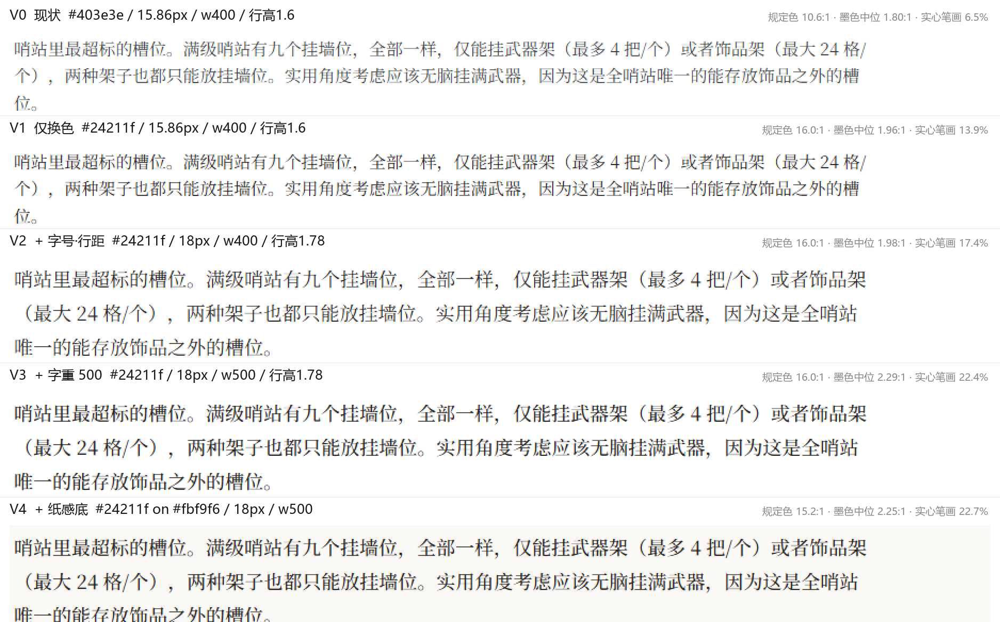

# 亮色模式正文可读性：实测诊断与四个方案

> **状态（2026-11-20）**：已全部落地并归档。方案 D（纸色底）、B（18px / 行高 1.78）、C（字重 500）、A（亮色色值）均已实施；配色审计只落地了零风险的 1/2/3 步，4–7 步按博主决定暂缓。实际改动清单见 §9 与 §12。
> 2026-11-20 · 对象：hexo-theme-ayeria 1.9.13 / Hexo 8.1.1 / Noto Serif SC
> 预览图：`01-five-variants-1x.png`（同一段文字的 5 种设置，1x 光栅化后放大 2 倍）、`02-page-before-after.png`、`03-paper-candidates.png`（纸色候选）、`04-code-surface.png`（代码块表面）、`05-paper-before-after.png`（本地构建前后对比）、`12`–`14`（分类页 / 标签页 / 公告条）
> 标记约定：**[实测]** 从源码、线上构建产物或真实渲染直接读到；**[推算]** 由 CSS 级联推算，未实测；**[待验证]** 需要在真机/你本人的显示器上确认。

---

## 0. 结论

「正文偏灰」是真的，但它**不是配色问题**。现状正文字色 `#403e3e` 在白底上是 **10.62:1**，超过 WCAG AAA（7:1）——比 GitHub 正文（15.80:1）浅，但比 WCAG 要求的底线深得多。把色值换成 `#24211f`（16.00:1）在实测渲染里只把"实心笔画占比"从 6.5% 提到 13.9%，肉眼看几乎无差别。

灰的来源是**笔画**，不是颜色：

1. 正文实际字号 **15.86px**、字重 400 的思源宋体，在 1x 屏上横画不足 1 像素。抗锯齿会把笔画像素抹成灰阶，于是**只有 6.5% 的墨迹像素真正达到规定色应有的深度**；墨迹中位亮度 53%（≈1.80:1），眼睛看到的就是这个平均值。WCAG 官方文档对这种现象有专门注记（见 §5）。
2. 页面里真正不达标的灰不在正文，而在**次级文字体系**：`--color-text-secondary = #999`（2.85:1）被用在日期、图注、上下篇导航标题上，且日期还套了 `font-weight: 300`。
3. 深浅两套正文 token 是对称的（`#403e3e` / `#d0d0d0`，都是约 10.6:1），但**感知不对称**：暗底亮字会向四周"胀"（光晕），亮底暗字会被白底"吃"（细笔画消失）。同一组数值，亮色模式看起来一定更轻。

推荐组合（按顺序落地）：**B（字号+行距）→ A（色值与次级文字）→〔可选〕C（字重 500）→〔可选〕D（纸感底）**。

> **2026-11-20 更新**：博主选定 **D（类纸底）优先落地，且只改亮色模式**。D 的落值、候选对照与推导见 §3「方案 D 的落值：为什么是 `#fbf8f6`」，实施状态见 §9。B / A / C 暂缓——B 与 C 的参数（`font-size` / `font-weight`）是模式无关的，一旦改动会同时改变暗色模式，与"本次仅调亮色"冲突，需另行确认。
只做 A 不解决问题（实测收益 9%），B 的收益最直接且零资源成本，C 是"最后一次加实"但需要多下载一套字重，D 是气质升级但要连带改引用块/代码块底色。

---

## 1. 现状：把「灰」拆成四个可度量的量

### 1.1 正文的真实参数 **[实测]**

在线上页面注入 `localStorage.darkmode=0` 后用 Chrome DevTools Protocol 读计算样式：

| 项 | 值 | 来源 |
|---|---|---|
| 段落颜色 | `rgb(64,62,62)` = `#403e3e` | `_tokens.styl:27` ← `_variables.styl:53`（`darken(sand-dark,30%)`） |
| 字号 | **15.862px** | `html 62.5%` → `body 1.4rem` → `.article 110%` → `.article-entry 103%`（`style.styl:15,25`；`article.styl:4,59`） |
| 字重 | 400 | 继承默认，`.article-entry` 未设 |
| 行高 | 25.3792px（1.6） | `article.styl:61` |
| 字体 | Noto Serif SC（webfont 已加载，`document.fonts.check` = true） | `typography.styl:30`；`head.ejs:37` 请求 `wght@400;700` |
| 段落宽 | 800px | 实测 `getBoundingClientRect().width` |
| 每行字数 | **50.4 字**（800 / 15.862） | 推算 |
| 移动端字号 | **15.2px** | **[推算]** `@media (max-width:768px) html{60%}`（`style.styl:90-92`）把 1rem 压到 9.6px |

### 1.2 为什么 10.62:1 看起来还是灰 **[实测]**

对 1x 渲染下的正文段落（885×80px）做像素统计：

| 指标 | 值 | 含义 |
|---|---|---|
| 规定色对比度 | 10.62:1 | 按 WCAG 公式算出来的"名义值" |
| 墨迹中位亮度 | 0.533 → **1.80:1** | 眼睛实际平均到的深度 |
| 墨迹达到规定色的比例 | **6.5%** | 只有 6.5% 的笔画像素深到 `#403e3e` 那个亮度以下 |

原因很物理：宋体 Regular 的竖画约为字号的 6%、横画约为 2.5~3% **[估算，按常见宋体字面比例]**。16px 时分别是 0.95px 和 0.4px——**横画根本不到 1 个像素**。浏览器不能画半像素，就用灰度"摊"开，于是整片文字的墨色被平均成 53% 灰。

这解释了为什么你会觉得"偏灰"而对比度工具却说"通过"：工具算的是 CSS 里写的颜色，你看的是光栅化以后的颜色。

### 1.3 页面里真正"灰"的地方不在正文 **[实测]**

| 元素 | 实际颜色 | 字号/字重 | 对白底对比度 | 判定 |
|---|---|---|---|---|
| `.article-entry p`（正文） | `#403e3e` | 15.86px / 400 | 10.62:1 | AAA，但见 §1.2 |
| `.article-date`（日期） | `#999` | 15.4px / **300** | **2.85:1** | **不达 AA** |
| `.caption`（图注） | `#999` | 14.3px / 400 | **2.85:1** | **不达 AA** |
| `.article-nav-caption`（上下篇标题） | `#999` | 15.4px / 700 | **2.85:1** | **不达 AA** |
| `.word_count`（字数统计） | `#717f8c`（硬编码） | 15.4px / 300 | 4.10:1 | 不达 AA |
| `--color-border`（`hr`、分割线） | `#999` | 1px | 2.85:1 | 装饰线可豁免，但视觉上"脏" |
| `--input-placeholder` | `#ccc` | — | 1.61:1 | 搜索结果框占位符 |

也就是说：正文是"名义达标、实际发虚"；次级文字是"实测就不达标"。**两件事要分开修**，改一个 token 修不了另一个。

### 1.4 明暗不对称 **[实测 + 推断]**

| 模式 | 正文 token | 对比度 |
|---|---|---|
| 亮色 | `#403e3e` on `#fff` | 10.62:1 |
| 暗色 | `#d0d0d0` on `#1c1f26` | 10.69:1 |

数值几乎一样，但你不会觉得暗色模式灰。这是显示器的物理特性：暗底亮字会向上"溢出"（halation），细笔画反而显得更粗；亮底暗字被白底的强反射压住，细笔画直接消失。**结论：亮色模式的正文必须比暗色模式"更实"才能看起来等重**，两套 token 保持对称是不成立的。[待验证] 具体差异在你的显示器上有多大。

---

## 2. 五种渲染的同台对比 **[实测]**

同一段文字，在线上页面注入不同 CSS 后 1x 光栅化截图，再放大 2 倍（保留 1x 的抗锯齿质感，不重新栅格化）：

| 变体 | 规定色 / 字号 / 字重 | 规定对比度 | 墨迹中位 | 实心笔画占比 |
|---|---|---|---|---|
| V0 现状 | `#403e3e` / 15.86px / 400 | 10.62:1 | 1.80:1 | 6.5% |
| V1 仅换色 | `#24211f` / 15.86px / 400 | 16.00:1 | 1.96:1 | 13.9% |
| V2 +字号行距 | `#24211f` / **18px** / 400 / 行高 1.78 | 16.00:1 | 1.98:1 | 17.4% |
| V3 +字重 | `#24211f` / 18px / **500** / 行高 1.78 | 16.00:1 | 2.29:1 | **22.4%** |
| V4 +纸感底 | `#24211f` on `#fbf9f6` / 18px / 500 | 15.23:1 | 2.25:1 | 22.7% |

三个可以直接读出来的结论：

1. **换色几乎没用**：V0→V1 规定对比度涨了 50%，实心笔画只从 6.5% 到 13.9%，肉眼几乎无感。这否定了"把字调黑就行"的直觉。
2. **字号+行距是性价比最高的一格**：V1→V2 实心笔画再涨 3.5 个点，同时每行字数从 50.4 降到 44.4（见 §5 的行宽标准）。
3. **字重 500 贡献最大**（17.4%→22.4%），但它是唯一需要动字体请求的一项。



---

## 3. 四个方案

### 方案 A：色值分层（正文压低一点，次级文字拉起来）

**改什么**：`_tokens.styl` 亮色那一段。

```stylus
:root
  --color-text             #24211f  // 16.00:1，暖近黑，保留 sand 家族色相
  --color-text-secondary   #6b6560  // 5.74:1，替代 #999
  --color-border           #ded9d3  // 发丝线，装饰用；功能性边界另设
  --input-placeholder      #767676  // 4.54:1
```

**实测效果**：正文 10.62 → 16.00，实心笔画 6.5% → 13.9%。
**成本**：4 行。**风险**：`--color-text` 同时被标题、目录、正文引用块继承，全局会"重"一点点；次级文字变深后，页头的元信息会比现在显眼，可能削弱"克制"感——这是审美取舍，不是可读性取舍。
**配套**：`.article-date` 的 `font-weight: 300`（`typography.styl:67`）建议改 400，小字号细体本身就是发虚的另一个来源。

### 方案 B：字号与行距（推荐先做）

**改什么**：`_partial/article.styl:58-61`。

```stylus
.article-entry
  font-size 1.8rem      // 18px，脱离 110%×103% 的百分比叠层
  line-height 1.78      // 32px
```

**实测效果**：实心笔画 13.9% → 17.4%；每行字数 50.4 → 44.4；移动端 15.2 → 17.3px（**[推算]**）。
**成本**：2 行，零资源成本。**风险**：标题按 em 继承会一起变大（H1 31.7 → 36px，H2 27.8 → 31.5px），需要过一眼；长文总高度增加约 **43%** **[推算]**（行数随字号增加 13.5%，行距再增加 11%，两者相乘）。
**为什么是 18px 而不是 16px**：WCAG 的"大字"阈值是 18pt≈24px，对正文无参考价值；真正的参照是行业实现的正文尺寸——中文维基百科 16px、Material body large 16sp、Apple HIG 正文 17pt。更实质的理由是：**竖画**在 16px 时 0.95px、18px 时 1.08px，刚好越过 1 像素；而**横画**在 24px 以下永远不足 1 像素。这解释了实测里"换色收益 9%、字号收益 3.5 点、字重收益 5 点"的排序——字号只能救竖画，字重两样都救。

### 方案 C：字重 500（效果最好，但要动字体请求）

**改什么**：
1. `layout/_partial/head.ejs:37` 的 URL 加一个 500：`wght@400;500;700`；
2. `.article-entry` 加 `font-weight 500`。

**实测效果**：实心笔画 17.4% → 22.4%，提升幅度是四项里最大的。已验证 `fonts.font.im` 会正常返回 500 这一档（行宽变化证明拿到的是真字形，不是浏览器合成）。
**成本**：多一份中文字重（按 unicode-range 分片，首屏只拉用到的几片，但总量增加）。**风险**：
- 思源宋体 Medium 的字形比 Regular 略"方"，与「书斋式克制」的轻盈感有张力——这是审美判断，[待验证]。
- 如果只写 `font-weight:500` 而不改 URL，浏览器拿不到 500 面会退回 400（**不会**自动合成），等于白写。这一点容易踩。

### 方案 D：纸感底（气质升级，连带面最大）

**改什么**：`--color-bg: #fbf9f6`，并同步把 `--color-surface`(#f4f4f4)、`--blockquote-bg`(#f5f5f5)、`--color-code-bg`(#f0f2f5) 这几个**冷灰**改暖，否则冷灰块压在暖白纸上会显脏。

**实测效果**：规定对比度 16.00 → 15.23（略降），眩光降低；纸感来自底色本身，不是来自对比度。
**成本**：6~8 行，但要逐个过引用块、代码块、表格、图片边缘。**风险**：白色背景的截图/图片会在暖底上显出方形边界；深色模式不受影响（`body.darkmode` 覆盖）。

### 方案 D 的落值：为什么是 `#fbf8f6`

#### 候选与依据

| 候选 | 值 | L\* | 相对纯白 ΔL\* | 正文 `#403e3e` 对比度 | 来源 |
|---|---|---|---|---|---|
| W 现状 | `#ffffff` | 100.00 | 0 | 10.62:1 | — |
| T Tufte 原值 | `#fffff8` | 99.83 | 0.17 | 10.58:1 | [tufte.css](https://github.com/edwardtufte/tufte-css)：`body { background-color: #fffff8 }` |
| **P 采用** | **`#fbf8f6`** | **97.75** | **2.25** | **10.05:1** | `sand` 的色相/饱和度 + 纸张明度（推导见下） |
| S 更重 | `#f7f4ef` | 96.29 | 3.71 | 9.68:1 | — |

对照渲染见 `03-paper-candidates.png`：**T 与纯白在 1x 屏上不可分辨**（ΔL\* 0.17 落在人眼阈值内），P 能读出"暖纸"但不构成颜色主题，S 已经开始读作 sepia 皮肤。

#### 为什么不直接抄 Tufte 的 `#fffff8`

它给不了你要的效果——ΔL\* 只有 0.17，本质上是"白"。它的价值在于**方向与出处**：`#fffff8` 是"R=G=255、B 减 7"的极轻暖白策略，且主题设计规范（`ayeria-aesthetic` §一）本来就把 Tufte CSS 列为内容层参照物，往这个方向走不算自创风格。

所以：**方向取自 Tufte，明度与色相另有可复算的依据**，两者都不属于"随手挑一个米色"。

#### 落值的推导（可复算）

1. **明度**：sRGB 白 L\*=100。印刷正文纸（胶版纸/轻型纸）的目视明度明显低于屏幕白 **[经验映射，非严格等价]**。取 **ΔL\* = 2.25**，理由是它是"可感知但不构成主题色"的区间中点：ΔL\* < 0.2 不可见（T），> 3.5 开始读作米黄皮肤（S）。CIELAB 的 L\* 差是判断面层级的常规依据。
2. **色相与饱和度**：不新起一套。取主题既有 `sand = #9e6a4d`（`_variables.styl:28`，HSL 21°/35%）的 H 与 S，只换明度 → `HSL(21.5°, 34%, 97.5%)` = **`#fbf8f6`**。这样纸面与正文色（由 `sand-dark` 压暗而来）同源，不是两个色系。
3. **填充面同步下沉**：纸面下沉多少，填充面就下沉多少（ΔL\* 全部 +2.25），保持原有层级差。

| token | 原值 | L\* | 新值 | L\* |
|---|---|---|---|---|
| `--color-bg` | `#ffffff` | 100.00 | `#fbf8f6` | 97.75 |
| `--blockquote-bg` | `#f5f5f5` | 96.54 | `#f1eeec` | 94.29 |
| `--hl-bg`（代码块） | `#f8f8f8` | 97.58 | `#f4f1ef` | 95.33 |
| `--inline-code-bg` | `#f0f2f5` | 95.42 | `#eeebe9` | 93.17 |

**这一步不能省。** 只改 `--color-bg` 不动填充面的话，代码块（`#f8f8f8`，L\*97.58）会与纸面（L\*97.75）几乎同色，代码块在视觉上会**消失**——这是本方案唯一容易踩的坑。

#### 与设计语言的冲突检查

| 规范条款（`ayeria-aesthetic`） | 检查结果 |
|---|---|
| 内容层「书斋式克制」，参照 Tufte CSS / gwern.net | 纸色即书纸，方向一致；未引入新色相 |
| 色值必须走 CSS 自定义属性，硬编码是异味 | 新增 `paper` / `paper-quote` / `paper-code` / `paper-inline` 四个 Stylus 语义变量，由 `_tokens.styl` 与 `highlight.styl` 消费 |
| 明暗无缝，新增组件必须两端适配 | 暗色 token 一个未改；`body.darkmode` 已完整覆盖这四个变量，切换逻辑不变 |
| 不创造第三种风格 | 层级归属不变，只换底色 |
| 品牌色仅 hover 出现 | 未触及 |

#### 代码块配色的边界

`highlight.styl` 的语法色来自 **VS Code Light+**（文件头注释写明）。本次只换底色，不动任何语法色。底色下沉后 `--hl-fg #383a42` 在 `#f4f1ef` 上仍是 10.08:1。

#### 附带发现

`--color-surface`（`#f4f4f4`）与 `--color-code-bg`（`#f0f2f5`）是**死 token**：全库 grep 只有 `_tokens.styl` 里的定义，没有任何消费方（代码块实际用的是 `--hl-bg`）。本次未动这两个值，后续可以删掉或接上。

---

## 4. 推荐

按落地顺序：

1. **B**（字号 18px + 行高 1.78）——单次改动收益最大，且顺手把移动端从 15.2px 拉回 17.3px，把每行字数拉回 clreq 建议的 48 字以内。**先做这一项就能验证"偏灰"是否缓解**。
2. **A**（色值分层）——同一次提交做完。次级文字的 2.85:1 是实打实的不达标项，跟"审美克制"无关。
3. **C**（字重 500）——单独一个提交，方便回滚；做完后看一篇文章再决定留不留。如果你觉得 Medium 太重，替代方案是把字号推到 19px（同样能增加笔画绝对宽度，且零资源成本）。
4. **D**（纸感底）——**本轮已采纳并实施**（2026-11-20）。先落纸色是因为它属于气质层面的决定，且暗色模式完全不受影响；B / A / C 待定，见 §9。

不建议：

- 只改颜色（方案 A 单独做）——实测收益 9%，不改观感，属于"改了等于没改"。
- 用 `-webkit-text-stroke` 或 `text-shadow` 给文字加粗——会糊边，且在 2x 屏上是纯损伤。
- 把正文改成思源黑体——那是另一套设计语言（内容层用宋体是主题的硬约束），可读性问题的根因不是衬线。

---

## 5. 参考：行业实现与标准

### 5.1 WCAG 2.2（可访问性标准的硬底线）

- SC 1.4.3 正文 **4.5:1**、大字号（≥18pt≈24px 或 14pt 粗体）**3:1**；SC 1.4.6（AAA）**7:1**。
- 依据文档：<https://www.w3.org/WAI/WCAG22/Understanding/contrast-minimum.html>

同一页里有一段直接针对本问题的注记（**这是本次诊断最重要的官方依据**）：

> Due to anti-aliasing, particularly thin or unusual fonts may be rendered by user agents with a much fainter color than the actual text color defined in the underlying CSS. This can lead to situations where text has a contrast ratio that nominally passes the Success Criterion, but has a much lower contrast in practice. Although not normatively required, in these cases authors are encouraged to choose a font with stronger/thicker lines, or to aim for a foreground/background color combination that exceeds the normative requirements of this success criterion.

翻译：细字体会被抗锯齿渲染得比 CSS 里定义的颜色浅得多，于是出现"名义通过、实际不通过"；作者应改用**更粗的字体**或**超出规范要求的对比度**。这正是 §1.2 那条 6.5% 的规范表述。

### 5.2 各设计系统的正文色（横向对照）

| 系统 | 正文色 | 底色 | 对比度 |
|---|---|---|---|
| GOV.UK Design System | `#0b0c0c` | `#ffffff` | 19.59:1 |
| IBM Carbon（Gray 100） | `#161616` | `#ffffff` | 18.10:1 |
| GitHub Primer（`--fgColor-default`） | `#1f2328` | `#ffffff` | 15.80:1 |
| 中文维基百科 **[实测]** | `#202122` | `#f8f9fa`（不是纯白） | 15.30:1 |
| 阮一峰博客 **[实测]** | `#111111` | `#f5f5d5`（米黄纸色） | 17.00:1 |
| **本站现状** **[实测]** | `#403e3e` | `#ffffff` | **10.62:1** |

链接：<https://design-system.service.gov.uk/styles/colour/> · <https://www.carbondesignsystem.com/building-blocks/foundations/color/tokens> · <https://primer.style/product/primitives/color/>

可以读出的两点：

1. 主流系统的正文色都落在 **15~20:1**，没有一个用 10.6:1 这一档——主流做法是"更黑"，不是"更灰"。
2. 两个中文阅读站点的**底色都不是纯白**（`#f8f9fa`、`#f5f5d5`）。这与书籍排版一致：正文用纸是微黄的胶版纸，不是印刷白。

### 5.3 书籍排版/中文排版的度量

- **行宽**：W3C i18n 关于中文行长的讨论稿给出上限 **48 字**（下限 10 字）——<https://github.com/w3c/i18n-discuss/blob/main/notes/wcag.md>。本站现在是 **50.4 字**，略超；18px 后是 44.4 字，落回区间内。
- **行距**：中文正文通行区间为字号的 **1.5~2.0 倍**；网页长文常用 1.7~1.8。现 1.6 偏紧（`article.styl:61`）。参见《中文排版需求》(clreq) <https://www.w3.org/TR/clreq/>。
- **每页/每屏字数**：书籍排版（如中文 32 开本）正文每行 25~35 字、每面 20~30 行；屏幕的通行做法是把行宽放宽、行距加大来补偿滚动的连续性。
- **墨色**：印刷正文用 100% K（不是灰），"灰"只出现在注释、图注等次级层级——这与本站的结构一致：**正文应该实，次级才该浅**。现在的问题恰好是"正文发虚、次级也浅"，两个层级挤在了一起。

### 5.4 WCAG 3 草案（APCA）

APCA 用 Lc 值替代对比度比值，并按字号/字重给不同阈值（常见口径：16px/400 需 Lc≈75，14px/400 需 Lc≈90）。W3C Silver 任务组页面记录了"字号与字重可互相补偿"的查表经验（例如 500 字重配 16px、400 字重配 18px 可达同一目标）——这正是方案 B/C 可互换的理论依据：<https://www.w3.org/WAI/GL/task-forces/silver/wiki/Visual_Contrast_of_Text_Subgroup>
（注：APCA 尚未定稿，具体阈值各家整理不一，此处只作方向参考。）

---

## 6. 验收方法

1. 改完后在 1x 屏上截图，用同一套墨迹统计脚本复测"实心笔画占比"，目标 **≥20%**。
2. DevTools 逐项核对：`.article-entry p`、`.article-date`、`.caption`、`.article-nav-caption` 的对比度 ≥4.5:1。
3. 移动端（375px 宽）复测字号与行宽。
4. 亮/暗模式各截一张同段落图做并排，确认暗色模式**没有**被 A 方案波及。
5. 长文回归：一篇 1 万字左右的文章看总高度增加是否可接受。

---

## 7. 顺带发现（不在本次范围）

| # | 现象 | 位置 | 性质 |
|---|---|---|---|
| 1 | `html 62.5%` × `body 1.4rem` × `.article 110%` × `.article-entry 103%` 四层百分比叠层，改任何一层都会连带全局 | `style.styl:15,25`；`article.styl:4,59` | 脆弱设计，建议把正文尺寸直接写成绝对值 |
| 2 | `.word_count` 用 `darken(gray,30%)` 硬编码，不走 token | `ayeria.styl:94` | 违反「语义化变量」约束 |
| 3 | `--color-border: #999` 同时承担发丝线与分割线，2.85:1 的线压在 16:1 的字旁边会读作"脏" | `_variables.styl:60` | 层级不清 |
| 4 | 输入框 placehoder `#ccc`（1.61:1） | `_tokens.styl:41` | 不达 AA |
| 5 | 移动端把根字号压到 60%，正文实际 15.2px | `style.styl:90-92` | 移动端比桌面更需要字号 |

---

## 8. 若采纳：变更清单

| 文件 | 改动 | 方案 |
|---|---|---|
| `themes/ayeria/source-src/css/_partial/article.styl` | `.article-entry` 的 `font-size 103%` → `1.8rem`，`line-height 1.6` → `1.78` | B |
| `themes/ayeria/source-src/css/_tokens.styl` | `:root` 下 `--color-text`、`--color-text-secondary`、`--color-border`、`--input-placeholder` 四行 | A |
| `themes/ayeria/source-src/css/_partial/typography.styl` | `.article-date` 等 `font-weight 300` → `400` | A |
| `themes/ayeria/layout/_partial/head.ejs` | 字体 URL `wght@400;700` → `wght@400;500;700` | C |
| `themes/ayeria/source-src/css/_partial/article.styl` | `.article-entry` 加 `font-weight 500` | C |
| `themes/ayeria/source-src/css/_tokens.styl` | `--color-bg` 及三个冷灰 surface 改暖 | D |

改完后需 `cd themes/ayeria && npm run build` 重新生成 `source/dist/main.css`（`dist` 是 Rollup 产物，不随 Stylus 源码自动更新）。

---

## 9. 实施状态（2026-11-20 03:47）

**已实施，未提交**（工作区改动，`git status` 可见）：

| 文件 | 改动 |
|---|---|
| `themes/ayeria/source-src/css/_variables.styl` | 新增 `paper` / `paper-quote` / `paper-code` / `paper-inline` 四个纸色变量（带推导注释）；`body-background` 由 `white` 指向 `paper` |
| `themes/ayeria/source-src/css/_tokens.styl` | `--blockquote-bg` 由 `#f5f5f5` 改为 `paper-quote` |
| `themes/ayeria/source-src/css/_partial/highlight.styl` | 亮色 `--hl-bg` → `paper-code`，`--inline-code-bg` → `paper-inline`（暗色段未动） |
| `themes/ayeria/source/dist/main.css` | `npm run build` 重新生成，已验证四个新值存在于产物中 |

验证：本地 `hexo server`（127.0.0.1:4000）实际取到的 `--color-bg` 为 `#fbf8f6`、`--hl-bg` 为 `#f4f1ef`，见 `05-paper-before-after.png`。暗色模式 token 与产物中的 `body.darkmode` 规则均未改动。

**未实施**：无（A / B / C / D 均已落地）。

**已实施（第三轮，2026-11-20 04:1x）：方案 A 亮色色值**

| 文件 | 改动 |
|---|---|
| `_tokens.styl` | `--color-text #403e3e → #24211f`（15.13:1 @纸底）、`--color-text-secondary #999 → #6b6560`（5.43:1）、`--input-placeholder #ccc → var(--color-text-secondary)`（1.61 → 5.43） |
| `_partial/ayeria.styl` | `.word_count` 的 `color darken(gray,30%)` 硬编码 → `var(--color-text-secondary)` |
| `_partial/typography.styl` | `.article-date` / `.article-category` / `.article-tag-list` / `.word_count` 的 `font-weight 300 → 400`（15.4px 的 Light 字重在小字号下发虚） |

未改：`--color-border`（维持 `#999`）。原因见 §11.6 —— 它还承担归档页时间线圆点（`archive.styl:65`）与 gitalk 评论框边框，一次性改成发丝线会让圆点消失；拆 token 的事并入配色审计一起做。

仍为 300 字重的三处：`.archive-*`（归档页）、`.cat-block-total`（分类页）、`.declare`（版权声明）——不在本次改动范围，要统一说一声。

**已实施（第二轮，2026-11-20 04:0x）：方案 B + C 全站生效** —— 博主确认"全站生效"，接受暗色模式同步变化：

| 文件 | 改动 |
|---|---|
| `themes/ayeria/source-src/css/_partial/article.styl` | `.article-entry`：`font-size 103%` → `1.8rem`、`line-height 1.6` → `1.78`、新增 `font-weight 500` |
| `themes/ayeria/layout/_partial/head.ejs` | 字体请求 `wght@400;700` → `wght@400;500;700`（不加这一项，`font-weight:500` 会静默退回 400） |
| `themes/ayeria/source/dist/main.css` | `npm run build` 重新生成 |

验证结果 **[实测，headless Chrome + 本地 hexo server]**：

- `.article-entry p` 计算样式：亮 `18px / 500 / 32.04px`、暗 `18px / 500 / 32.04px`；移动端（375px）`17.28px / 500`；
- 500 是真字形而非合成：拉丁文本在 400/500/700 三档宽度分别为 396.83 / 402.47 / 415.78px，且 `document.fonts` 中 400/500/700 均为 loaded（CJK 字幅恒为 1em，用中文测宽度测不出差别，别用中文验证字重）；
- 无横向溢出：1280px 与 375px 下 `scrollWidth === innerWidth`；
- 代码块字号仍是 14px（固定值，未随正文放大），窄屏 13.44px；
- 首页摘要卡（`.articles .article-entry`）同步变 18px/500，卡片高度 173px，排版正常；
- `npm test`（stylint）通过。

---

## 10. 暗色模式应用新排版的实测（2026-11-20 03:55）

问题：B / C 的参数模式无关，上了就同时改暗色。为决定"要不要上"，在本地构建（`hexo server`，亮色纸色已生效）里把 `.article-entry` 覆盖为 `font-size:1.8rem; line-height:1.78; font-weight:500`，暗色模式截图对比。

| 状态 | 字号/字重/行高 | 文本区亮像素占比 | 亮像素平均亮度 |
|---|---|---|---|
| 暗色现状 | 15.86px / 400 / 1.6 | 6.51% | 0.454 |
| 暗色 + 新排版 | 18px / 500 / 1.78 | **7.87%**（+21%） | 0.488 |

"亮像素占比"衡量的是暗底上被文字点亮的面积；+21% 意味着同样的阅读动作下，眼睛收到的笔画信号多了两成。对照图：`06-dark-typography.png`（三态同框：暗色现状 / 暗色新排版 / 亮色纸底+新排版）、`07-dark-page-before-after.png`（整页效果）。

主观判断 **[待博主确认]**：暗色下 500 字重不会显粗——暗底亮字本身有光晕，视觉上会把笔画"撑"开；18px 之后行宽从 50 字降到 44 字，暗色长文的阅读节奏更接近亮色。

代价：中文 webfont 多一档 500（按 unicode-range 分片）；正文区总高度约 +43% **[推算]**（行数 ×1.135，行距 ×1.11）。

三条路线的取舍：

| 方案 | 暗色是否变 | 排版套数 | 备注 |
|---|---|---|---|
| (a) 只保留纸色 | 不变 | 1 | 最保守，但亮色拿不到字号/字重收益 |
| (b) 全站生效 | 变 | 1 | 推荐：一套参数，暗色同样受益 |
| (c) 仅亮色生效 | 不变 | 2 | 需 `body:not(.darkmode)` 限定，长期维护成本高 |

---

## 11. 配色审计：可合并候选（2026-11-20）

### 11.0 盘点

| 指标 | 数值 |
|---|---|
| CSS 自定义属性（不同名） | **89** 个，其中 16 个是语法高亮色板（`--hl-*`），设计层 73 个 |
| 定义条数（亮 + 暗各一份） | 182 条 |
| 不同十六进制值 | **102** 个（其中 24 个属于 VS Code 语法色板） |
| 色值引用处 | 145 处 |

判断标准：**语义相同 + ΔE00 ≤ 2（肉眼不可分辨）**才列入"可合并"；语义不同即使同值也只作"名义统一"，不做合并。

### 11.1 候选 A：语法高亮的"同一色承担多个角色"——**不建议合并**

| 同值组 | 值 | 说明 |
|---|---|---|
| `--hl-boolean` = `--hl-tag` | `#569cd6` | VS Code Light+/Dark+ 的官方语义 |
| `--hl-class` = `--hl-builtin` | `#267f99` / `#4ec9b0` | 同上 |
| `--hl-variable` = `--hl-property` | `#001080` / `#9cdcfe` | 同上 |
| `--hl-fg` = `--hl-operator` | `#383a42` / `#d4d4d4` | 同上 |

这些重复来自 VS Code 主题本身，不是本项目自造的冗余。合并会破坏"语法色照抄 VS Code Light+/Dark+"的可追溯性，**保持原样**。

### 11.2 候选 B：死 token（零引用）——**可直接删除**

| token | 定义位置 | 说明 |
|---|---|---|
| `--color-surface` | `_tokens.styl:35`（亮/暗各一条） | 全库无 `var()` 引用 |
| `--color-code-bg` | `_tokens.styl:36` | 实际代码块用 `--hl-bg` |
| `--color-code-text` | `_tokens.styl:37` | 实际行内代码用 `--inline-code-text`（**同值 `#d63384`，同语义**） |
| `--reward-text` | `reward.styl:10` | 打赏弹窗实际用 `--reward-tab-active-text` |

删除后定义条数 182 → 174。风险为零。

### 11.3 候选 C：功能层浮层底色（4 → 1）

| token | 亮色 | 暗色 |
|---|---|---|
| `--search-bg` | `#ffffff` | `dark-surface`（`#2a2f3a`） |
| `--reward-bg` | `rgba(252,250,247,.97)` | `rgba(42,47,58,.97)` |
| `--share-modal-bg` | `rgba(252,250,247,.97)` | `rgba(42,47,58,.99)` |
| `--share-wrap-bg` | `rgba(250,248,245,.97)` | `rgba(42,47,58,.97)` |

- **暗色**：四个 token 其实是**同一个 RGB**，只有 alpha（.97/.99）不同 → 收敛为 `--surface-float` + `--surface-float-alpha`，视觉零变化。
- **亮色**：`#fcfaf7` 与 `#faf8f5` 的 ΔE00 = **0.40**（完全不可分辨），与纸底 `#fbf8f6` 的 ΔE00 = 0.90。只有 `--search-bg` 的纯白是异类（ΔE00 1.88）——纸底落地后，纯白弹窗反而比页面更亮，读作"补丁"。

建议：亮色统一为 `#fcfaf8`（比纸底亮 1 档，仍属同一暖白家族），暗色沿用 `#2a2f3a`。风险：中（三个组件要一起回归）。

### 11.4 候选 D：功能层文字（8 处 → 3 个语义 token）

| 层级 | 值 | 出现处 | 组内 ΔE00 |
|---|---|---|---|
| 强 | `#333333` | `--search-input-text`、`--reward-tab-active-text`、`--reward-text`(死) | — |
| 正文 | `#555555` | `--share-modal-text`、`--reward-btn-text`、`--search-text-color` | 11.35 vs 强 |
| 次要 | `#666666` | `--reward-tab-text`、`--search-close-color` | 6.17 vs 正文 |
| 弱 | `#777777` | `--reward-subtext`、`--search-input-placeholder` | 6.64 vs 次要 |

四个层级之间的 ΔE00 都在 6 以上，**层次是有意的，不能塌成一级**；可合并的是"同一级在三个组件里各写一遍"。建议提取 `--fg-strong` / `--fg-body` / `--fg-muted`（外加一个 `--fg-weak`），把 8 处声明收敛为 3–4 处。

### 11.5 候选 E：muted 灰（6 → 1）

| 值 | 出现处 | 对 `#999` 的 ΔE00 |
|---|---|---|
| `#999999` | `--hl-gutter`、`--notice-icon`、`--reward-btn-icon`(暗)、`--reward-tab-text`(暗)、`--search-input-placeholder`、`--share-icon-color`(暗) | — |
| `#969696` | `--notice-text` | **0.97**（看不出差别） |
| `#888888` | `--reward-btn-icon`(亮) | 5.74 |
| `#7a7060` | `--share-icon-color`(亮) | 16.85（异相暖灰，明显偏离） |

建议：`#969696` 直接并入 `#999`；`#888888` 与 `#999` 二选一；`#7a7060` 需要单独决定（它是唯一暖调的图标灰，暖纸底其实更"和"，但要与其他图标统一）。注意 `#999` 在纸底上只有 **2.69:1**，作为图标色可以，作为**文字**（`--search-input-placeholder`、`--notice-text`）不达 AA。

### 11.6 候选 F：分隔线 / 细线（6 → 2）

| 值 | 出现处 | 簇 |
|---|---|---|
| `#eeeeee` | `--search-divider` | 簇 1 |
| `#e8e8e8` | `--search-close-bg` | 簇 1（与 `#e6e6e6` ΔE00 **0.43**） |
| `#e6e6e6` | `--notice-border` | 簇 1 |
| `#dedede` | `_extend.styl` 表格边框（3 处） | 簇 2（与 `#dfdede` ΔE00 **0.52**） |
| `#dfdede` | `articles.styl` 卡片虚线框 | 簇 2 |
| `#e3e6eb` | `--fn-sep` | 偏冷，ΔE00 2.6–3.2 |

建议收敛为 `--line-soft`（簇 1）与 `--line-strong`（簇 2），`--fn-sep` 并入 `--line-soft` 并顺带转暖。

### 11.7 候选 G：暗色描边重复

`--color-border`（`#3b414c`）与 `--fn-sep`（`#3b414c`）**完全同值同角色**（都是暗色发丝线）→ `--fn-sep` 直接引用 `var(--color-border)`。另有 `--color-tag-bg` `#3a3f4a` 与它的 ΔE00 仅 **0.82**，但一个是"面"、一个是"线"，不建议合并（合并后标签会失去底色）。

### 11.8 同值但语义不同（**不该合并，但该统一引用**）

| 值 | 位置 | 问题 |
|---|---|---|
| `#ea434a` | `--color-warning`、Stylus `red`、`.article-topping` 的 `background-color`（`article.styl:25`，硬编码） | 置顶徽章没走 token |
| `#000000` | `--friend-link-text`（亮色） | 全站唯一还在用纯黑的地方，与 `#24211f` 冲突 |
| `#bbbbbb` | `navbar.styl` 字面量 + Stylus `sand-gray` | 重复定义 |
| `#403e3e` | `layout.styl` 字面量（移动端侧栏背景） | 与旧 `body-color` 同值；`--color-text` 已改为 `#24211f`，这里作为**背景**保持 `#403e3e` 是对的，但应引用变量而非硬编码 |

### 11.9 纸底落地后需要复核的对比度（全部 **[实测]**）

| token | 前景 | 背景 | 对比度 | 判定 |
|---|---|---|---|---|
| `--color-text` | `#24211f` | 纸底 | 15.13:1 | ✅ AAA |
| `--color-text-secondary` | `#6b6560` | 纸底 | 5.43:1 | ✅ AA |
| `--color-link` | `#1b6f9e` | 纸底 | 5.21:1 | ✅ AA |
| `--input-placeholder` | 同次级文字 | 纸底 | 5.43:1 | ✅ AA（本轮已修） |
| `--fn-marker` | `#6f7783` | 纸底 | **4.28:1** | ⚠️ 纸底使其从 4.52 掉到 AA 线下 |
| `--search-input-placeholder` | `#999999` | `#f5f6f8` | **2.63:1** | ❌ 既有问题 |
| `--notice-text` | `#969696` | 纸底 | **2.80:1** | ❌ 既有问题（公告条正文） |
| `--notice-icon` | `#999999` | 纸底 | **2.69:1** | ❌ 既有问题 |
| `--hl-gutter` | `#999999` | `#f4f1ef` | **2.53:1** | ❌ 代码行号（次要件，可接受但不达标） |
| `--inline-code-text` | `#d63384` | `#eeebe9` | **3.79:1** | ❌ 既有问题 |
| `--color-warning` | `#ea434a` | 纸底 | **3.68:1** | ❌ 既有问题 |

### 11.10 建议落地顺序

> **2026-11-20 更新**：博主决定**不做系统性合并**（不同组件仍可能需要分别配色），因此只落地了第 1/2/3 步（零视觉变化），第 4–7 步暂缓。实施记录见 §12。

1. **删死 token**（§11.2）——零风险、零视觉变化。
2. **硬编码改引用**（§11.8 的 `#000` / `#ea434a` / `#bbbbbb` / `#403e3e`）——零视觉变化，纯清理。
3. **暗色浮层底合并**（§11.3 暗色部分）+ `--fn-sep` 引用 `--color-border`（§11.7）——零视觉变化。
4. **muted 灰收敛**（§11.5）——低风险，但要先定 `#999` 还是 `#888`，以及 `#7a7060` 的去留。
5. **分隔线收敛**（§11.6）——低风险。
6. **亮色浮层底统一**（§11.3 亮色部分）——中风险，三个弹窗一起回归。
7. **浮层文字提取语义 token**（§11.4）——中风险，改动面最大、收益最小，建议最后做。

不建议：合并亮/暗两套（本来就该不同）、合并语法色板（§11.1）、把 `#333/#555/#666/#777` 塌成一级（层级会消失）。

---

## 12. 第二轮改动（2026-11-20 04:37）

博主确认：**配色不做系统性合并**（不同组件可能仍需要分别配色），只做"语义与颜色都完全无风险"的 1/2/3；另接受纸底连带的可读性修复与分类/标签页的层级修复。搜索框占位符不动；归档页、页脚版权声明不动。

### 12.1 审计 1：删除死 token（零视觉变化）

`--color-surface`、`--color-code-bg`、`--color-code-text`（`_tokens.styl`，亮暗各一条）、`--reward-text`（`reward.styl`，亮暗各一条）。同时删掉因此失去引用的 Stylus 变量 `dark-fn-sep`。定义条数 182 → 174。

### 12.2 审计 2：硬编码改引用（零视觉变化）

| 位置 | 原写法 | 现写法 |
|---|---|---|
| `friends.styl` | `--friend-link-text: #000` | `var(--color-text)` |
| `article.styl` `.article-topping` | `background-color #ea434a` | `var(--color-warning)` |
| `navbar.styl` | `color #bbb` | `color sand-gray` |

### 12.3 审计 3：暗色浮层与发丝线去重（零视觉变化）

- `reward.styl` / `share.styl` 的暗色 `rgba(42, 47, 58, .97/.99)` 改为 `rgba(dark-surface, .97/.99)`——编译产物逐字节不变，但底色来源收敛到 `dark-surface` 一处。
- `_tokens.styl` 暗色 `--fn-sep: dark-fn-sep` → `var(--color-border)`（两者本来就都是 `#3b414c`）。

### 12.4 纸底连带的可读性修复

| 项 | 原值 | 新值 | 修复后对比度 |
|---|---|---|---|
| 脚注序号 `--fn-marker` | `#6f7783` | `#68707c` | 4.28 → **4.73:1** |
| 脚注回链 `a.footnote-backref` | `opacity .75`（叠加后 ≈3.3:1） | `opacity 1` | **4.73:1**，hover 转链接色 |
| 公告条正文 `--notice-text` | `#969696`（2.80） | `var(--color-text-secondary)` | **5.43:1** |
| 公告条图标 `--notice-icon` | `#999`（2.69） | `var(--color-text-secondary)` | **5.43:1** |
| 代码行号 `--hl-gutter` | `#999`（2.53） | `#726c67` | **4.60:1**（仍明显弱于代码正文 10.08:1） |
| 行内代码 `--inline-code-text` | `#d63384`（3.79） | `#b82a6e` | **4.92:1**，保持同一粉色系 |
| 置顶徽章 `--color-warning` | `#ea434a`（白字 3.89） | `#cc3638` | 白字 **5.06:1**，红字压纸底 **4.78:1** |

### 12.5 分类页 / 标签页：把 opacity 层级换成颜色层级

两页原本用 `opacity` 表达层级（0.35 / 0.45 / 0.5 / 0.7），在纸底 + 更深的正文色之下，低档位只剩 2.1–2.8:1。改法是**保留层级、换掉实现**：文字用颜色 token 分级，只有装饰线继续用 opacity。

| 元素 | 原实现 | 现实现 | 对比度 |
|---|---|---|---|
| 分类名 `.cat-block-name` | inherit | inherit | 15.13:1 |
| 分类计数 `.cat-block-total` | `opacity .45` | `var(--color-text-secondary)` | 2.75 → **5.43:1** |
| 子分类计数 `.cat-subcount` | `opacity .45` | `var(--color-text-secondary)` | 2.75 → **5.43:1** |
| 标签名 `.tag-cloud-item` | `opacity .7` | `color var(--color-text)`，hover 改左竖线颜色 | 5.72 → **15.13:1** |
| 标签计数 `.tag-cloud-count` | `opacity .45` | `var(--color-text-secondary)` | 2.75 → **5.43:1** |
| 标签统计 `.tag-cloud-stats` | `opacity .5` | `color secondary` + `strong` 用正文色 | 3.15 → **5.43 / 15.13:1** |
| 排序按钮 `.tag-sort-btn` | `opacity .35 / .65 / 1` | `color secondary`，hover/active 转正文色 | 2.11 → **5.43 / 15.13:1** |
| 标签搜索框 `.tag-cloud-input` | `opacity .35`，下划线 `currentColor` | 文字正文色、下划线 `--color-border`、聚焦转正文色、placeholder 见次级色 | 占位符 2.11 → **5.43:1** |
| 装饰竖线 `.tag-cloud-item` | `2px currentColor` @.7 | `2px var(--color-text-secondary)` | 次级，不抢名字 |

装饰性线条（分类页的分隔线 `opacity .12`、缩进引导线 `opacity .18`）保持不变。

### 12.6 本轮未做

- 搜索弹窗占位符 `--search-input-placeholder`（按要求不改）。
- 归档页 `.archive-*`、页脚 `.declare` 的字重 300（按要求不改）。
- 两处历史遗留：`.article-inner` 之外的 `background white`（分享浮层）、`_extend.styl` 表格边框 `#dedede`——属于审计 §11.6 的"分隔线收敛"，未动。
